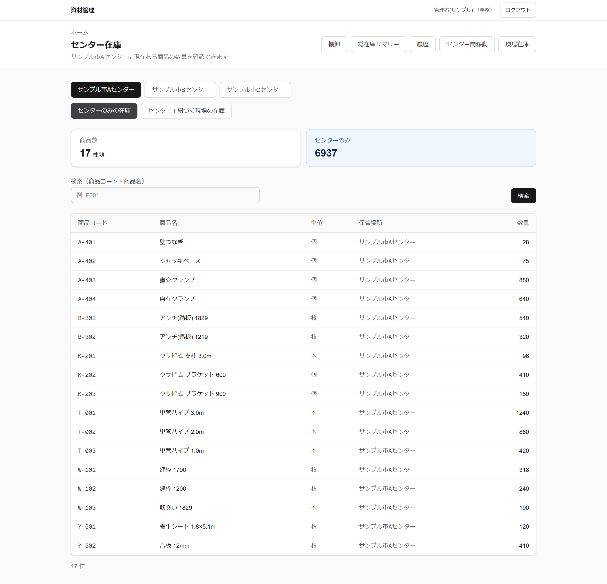

# 業務システム開発ポートフォリオ

実案件で開発した業務システムのソースコードです。要件定義から設計・実装・テスト・運用ドキュメントまで、一人で担当しました。
**顧客名・人名・メールアドレス・Google の各種 ID はすべてダミーに置き換えています。**(`サンプル建設`、`サンプル歯科A`、`SAMPLE_ID_001` など)

## まず見てほしいもの

### 1. 仮設資材 在庫・発注・リース管理システム(建設業)
Next.js + TypeScript + Supabase。LINE と Excel の運用を置き換えた、一番規模の大きい案件です。
在庫台帳方式・DB 関数による一括更新・二重送信対策・ロール別アクセス制御などが見どころです。

➡ [**詳細(構成図・設計のポイント・画面)を見る**](サンプル建設/資材発注/README.md)

### 2. 歯科医院グループ向けの在庫・棚卸し管理(Google Apps Script)
QR による入出庫・棚卸し・期限アラート・発注候補の管理。画面のスクリーンショット付きです。

➡ [詳細を見る](サンプル商事/棚卸し/README.md)

## 全体一覧

### サンプル建設(建設業向け)
| フォルダ | 概要 | 技術 |
|---|---|---|
| [`サンプル建設/資材発注`](サンプル建設/資材発注/README.md) ⭐ | 仮設資材の在庫・出庫依頼・発注・リース管理 | Next.js, TypeScript, Supabase |
| `サンプル建設/資材発注/GENBA_WORK` | 現場管理: 職人進捗、是正報告、ダッシュボード など | Google Apps Script |
| `サンプル建設/資材発注/LINE発注` | LINE からの発注受付 | Google Apps Script |
| `サンプル建設/現場資材予測システム` | 現場の資材必要量予測 | Python |
| `サンプル建設/職人報告` | 職人の日報・報告 | Google Apps Script |
| `サンプル建設/是正報告書システム` | 是正報告書の作成 | Google Apps Script |

### サンプル商事(歯科医院グループ向け)
| フォルダ | 概要 | 技術 |
|---|---|---|
| [`サンプル商事/棚卸し`](サンプル商事/棚卸し/README.md) ⭐ | 在庫・棚卸し・QR 管理(スクリーンショットあり) | Google Apps Script |
| [`サンプル商事/インカム整理`](サンプル商事/インカム整理/README.md) | インカム機器の台帳・修理管理(スクリーンショットあり) | Google Apps Script |
| [`サンプル商事/ジョブメドレー`](サンプル商事/ジョブメドレー/README.md) | 求人文・スカウト文・サムネイル案の制作支援(スクリーンショットあり) | Google Apps Script, OpenAI API |
| `サンプル商事/給与計算` | 給与の按分計算ツール | Python |

## 補足
- `tools/gas-screenshots/` : GAS の画面をログイン不要・ダミーデータで撮影する自作ツール(棚卸し・インカム整理・ジョブメドレーのスクリーンショットに使用)。
- `tools/mock-screens/` : 資材発注システムの実アプリを、ダミーデータを返すモック Supabase につないで起動し、画面を撮影するツール(顧客データ・Supabase 接続なし)。

## 注意
- 設定値(スプレッドシート ID など)は `SAMPLE_ID_xxx` のプレースホルダです。動かすには自分の環境の値に置き換えてください。
- Supabase 等の秘密情報は環境変数から読み込む実装で、リポジトリには含まれていません。
