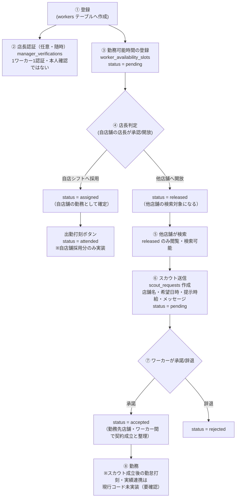
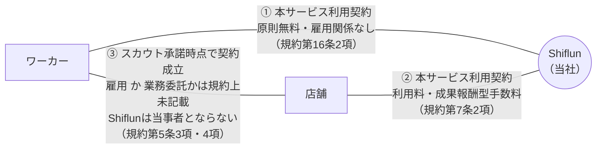

# 1. 事業概要・マッチングフロー

[← 目次に戻る](README.md)

## 1.1 サービス概要

Shiflun（シフルン）は、飲食業界に特化したシフト連動型マッチングプラットフォーム（Web / 将来的にアプリ）です。

一言でいうと、「店舗の日常のシフト管理」をフックにして、店舗のシフトに入れなかった（アサインされなかった）ワーカーの空き時間を、他店舗からのスカウト対象として開放する仕組みです。

- **ワーカー**: 自身の勤務可能日時を登録すると、勤務先店舗の店長が確認し、自店で使わない枠は他店舗に開放される。他店舗からスカウトが届き、承諾すれば新しい勤務先が見つかる。
- **店舗**: 自店の勤務実績（店長認証）で信頼性が可視化された「即戦力」ワーカーを、条件検索してスカウトできる。

現時点（2026-08-13）では **ヒアリング用のデモ MVP** であり、認証（ログイン）・決済・通知は未実装です（詳細は 1.3・1.4 節）。

## 1.2 登場人物・用語

| 用語 | 定義 |
|---|---|
| ワーカー | 本サービスを通じて単発または継続的な就業を希望する個人（飲食店バイト） |
| 店舗 | ワーカーを募集し、雇用または業務委託を行う法人・個人事業主。現行コード上は `stores` テーブル（Phase 7 で追加、未使用）と `store_name` の自由入力が併存 |
| 勤務先店舗 / 自店舗 | ワーカーが現在所属している店舗（`workers.current_store`） |
| スカウト元店舗 / 他店舗 | 自店舗以外で、開放された空き時間を検索してスカウトを送る店舗 |
| 店長認証 | 店舗責任者がワーカーの在籍・勤務実績を確認する「実績バッジ」機能。**本人確認（eKYC）とは別物**（1.4 節参照） |
| Shiflun / 当社 | 本サービスの運営者。現行の利用規約上は契約当事者にならない位置づけ（利用規約第5条4項） |

## 1.3 マッチングフロー（現在の実装ベース）

以下は `supabase/migrations/*.sql` と `lib/actions/*.ts` の実装から起こした、**実際に動くフロー**です。ホームページ（`app/page.tsx`）に記載の簡易フロー（登録→勤務希望→店長確認→他店舗からスカウト依頼）を、DB上のステータス遷移まで含めて分解しています。

### 各ステップの補足（現在の実装の事実関係）

1. **登録**: `/workers/register`（自己登録）と `/workers/join-store`（店舗を選んで自己申告）の2経路があり、**いずれも店長の事前承認を必要としません**（Phase 8-B、migration `013_self_report_join_and_worker_flags.sql`）。`/workers/join-store` は既存スタッフの `business_type` を引き継いで即座に `workers` レコードを作成し、店長には `/managers/staff` の一覧上で共有されます。店長は一覧を見て見覚えのない人物がいた場合に「通報」でき、通報は `worker_flags` テーブルに記録され、店長側で「対応済み（不正の疑いあり）」または「問題なし」に処理できます。
   > 以前は `/workers/join-store` 経由の登録に店長の事前承認（`store_join_requests` の承認フロー）を必須としていましたが、弁護士・自治体（市役所）への相談で、この事前承認フローが有料職業紹介事業の「あっせん」に該当しうると指摘を受けたため、自己申告制＋事後通報に変更しました。**この変更のみで懸念が解消するとは限らず、要再確認**（[05_open-issues.md](05_open-issues.md) #14）。
2. **店長認証**: 店舗責任者が「勤務実績を確認した」ことを示すコメント付きバッジです。**本人確認（eKYC）ではありません**。現行コードは認証済み(`verified`)かどうかを勤務可能時間の登録条件にはしておらず、未認証でもワーカーは勤務希望を提出できます。
3. **勤務可能時間の登録**: ワーカーがカレンダーから日付・時間帯を選び一括登録します（`status = pending`）。
4. **店長判定**: 自店舗の店長のみが `assigned`（自店シフト採用）か `released`（他店舗へ開放）を選べます（`updateShiftRequestStatus`、対象は `pending` のみ）。
5. **他店舗への公開**: `released` になった枠だけが他店舗の検索対象になります（`app/companies` の検索・スカウト導線）。
6. **スカウト送信**: 他店舗が店舗名・希望勤務日時・提示時給・メッセージを入力して送信します（`createScoutRequest`）。この時点では契約は成立しません（利用規約第5条2項に対応する設計）。
7. **承諾/辞退**: ワーカーがマイページでスカウトに対し `accepted`/`rejected` を選びます（`updateScoutStatus`）。**承諾した時点で店舗・ワーカー間に契約が成立する、という整理が利用規約第5条3項の建付けです。**
8. **勤務**: 出勤打刻ボタン（`clockInShift`）は `status = assigned`（自店舗採用分）のみを対象としており、スカウトが成立した他店舗での勤務について、勤怠打刻・時間確定・実績確定までを連携する機能は **現行コードには実装されていません**（★要確認：本格営業前にどう扱うか）。

## 1.4 今後の構想（要件定義書ベース・未実装）

`要件定義書_業種特化型・シフト連動型マッチングアプリ.pdf` に記載された、将来的に実装予定の機能です。**現時点ではコード上に一切存在しません。**

| 構想 | 内容 |
|---|---|
| eKYC（本人確認） | 身分証によるオンライン本人確認を必須化。同一人物の重複登録・直接雇用への引き抜きをシステム的に検知・ブロック |
| ダイナミックプライシング | 店舗がスカウト時に自由に時給を設定できる仕組み（現行コードは提示時給の入力欄自体は既にある） |
| リアルタイム勤怠打刻 | GPS 位置情報＋店舗設置QRコードスキャンによる出退勤打刻（現行は自己申告ボタンのみ） |
| 勤怠承認・実績確定 | 店舗が打刻データを確認し、実働時間と支払報酬額を確定 |
| 自動決済・請求管理 | Stripe 決済 API 等を通じた手数料決済、または月次の自動請求書発行（詳細は [02_money-flow.md](02_money-flow.md)） |
| マネタイズ | 完全成果報酬型手数料（実際に勤務が行われた実績報酬から一定割合を店舗へ請求）＋アプリ内広告収益 |

## 1.5 契約当事者の想定

現行の利用規約（`利用規約（ワーカー・店舗共通）V3.md`）の建付けでは、以下のような契約関係を想定しています。

| 当事者A | 当事者B | 関係 | 現行規約上の建付け | 要確認事項 |
|---|---|---|---|---|
| ワーカー | Shiflun | 本サービス利用契約 | 原則無料。当社は使用者・被用者関係に該当しないと整理（規約第16条2項） | - |
| 店舗 | Shiflun | 本サービス利用契約 | 有料（利用料または成果報酬型手数料、規約第7条2項）。具体的な資金の流し方は [02](02_money-flow.md) 参照 | 手数料体系の法的性質（職業紹介手数料に該当するか等） |
| ワーカー | 店舗 | スカウト承諾により契約成立（規約第5条3項） | 「報酬（時給等）」という表現があり雇用契約を示唆するが、**雇用契約か業務委託契約かは規約上明記されていない** | ★要確認（[03](03_questions-hyogo-labor-bureau.md) Q4・[04](04_questions-lawyer.md) 2章） |

Shiflun は契約の当事者とはならず、契約内容について責任を負わない（規約第5条4項・第10条）という整理を現行案は取っていますが、**この整理自体が職業安定法・労働基準法上どう位置づけられるかは未確認です**。この点は 1.3 節のスカウト機能（条件を指定して特定のワーカーへ個別に勧誘する機能）の性質と合わせて、[03_questions-hyogo-labor-bureau.md](03_questions-hyogo-labor-bureau.md) で確認します。
