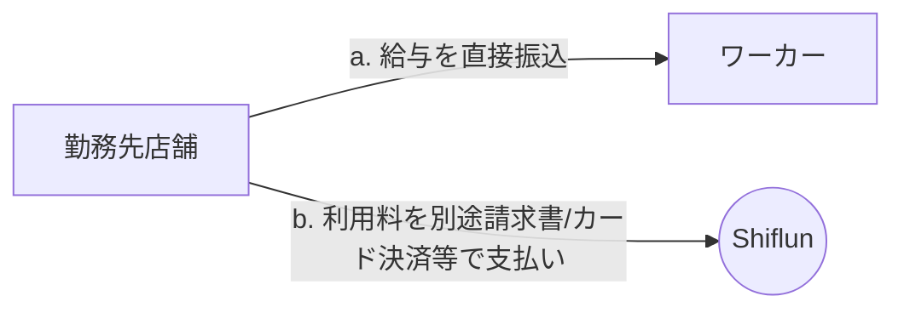
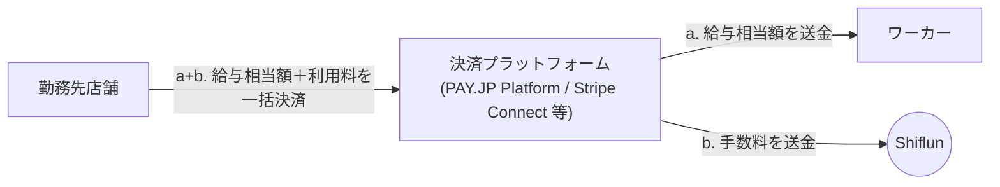

# 2. お金の流れ

[← 目次に戻る](README.md)

## 2.1 前提

- **Shiflun は、店舗からワーカーへの給与を立て替えない。** Shiflun が一時的にせよ給与相当額を自社の資金として受け取り、そこからワーカーへ送金する「立替払い」構造は採用しない前提とする。
- 現行の利用規約第7条は「ワーカーは原則無料」「店舗は利用料または成果報酬型手数料を支払う」とのみ定めており、**支払方法（誰が誰にいつどう払うか）は規約上一切具体化されていません。**
- 現在の実装（コード）には決済機能が一切ありません。スカウトに含まれる「提示時給」（`scout_requests.offered_hourly_wage`）は、あくまで店舗がワーカーに提示する労働条件の一項目としてDBに保存されるだけで、実際の支払い手段・タイミングはシステムの外側（店舗・ワーカー間の直接のやり取り）に委ねられています。

## 2.2 お金の流れの構成要素

本サービスにおける金銭の流れは、性質の異なる2つの流れに分解できます。

| # | 流れ | 内容 |
|---|---|---|
| a | 勤務先店舗 → ワーカー | 給与（時給 × 実働時間）。雇用契約か業務委託契約かにより性質・支払ルールが変わりうる（★要確認、[03](03_questions-hyogo-labor-bureau.md) Q6・Q9） |
| b | 勤務先店舗 → Shiflun | 本サービスの利用料。要件定義書上の構想は「完全成果報酬型手数料（実際に勤務が行われた実績報酬から一定割合を請求）」＋任意の月額シフト管理プラン |

この a・b をどう資金として流すかについて、3つの案を検討する。

## 2.3 資金の流し方 3案

### 案A：無仲介（Shiflun は資金に一切触れない）

Shiflun はワーカーへの支払いを仲介せず、「この額をこの人に払ってください」と店舗に伝えるのみ。利用料 b は a とは別建てで、月次請求書や汎用のカード決済（Stripe等の単純な決済、資金分配なし）で店舗から直接回収する。

| 観点 | 内容 |
|---|---|
| メリット | 資金移動業（資金決済法）の登録が不要になる可能性が高い（★要確認）。開発コストが低く、最速でMVP運用に入れる |
| 問題点 | ワーカーへの支払いを Shiflun が保証できず、未払いが起きても関知できない（信頼性・トラブル対応上のリスク）。実際に支払われたかの確認手段がなく、成果報酬（b）の算定根拠（実働時間・支払額）を Shiflun 側で正確に把握しにくい |
| 要確認事項 | このスキームが職業安定法上の「有料職業紹介」の手数料規制（求職者からの手数料徴収禁止・店舗側手数料の上限等）に抵触しないか。給与を店舗が直接払う場合でも、Shiflun が「いくら払うか」を指示する行為の法的性質 |

### 案B：プラットフォーム型決済（PAY.JP Platform / Stripe Connect 等）を挟む

店舗からの支払いを、資金移動業等のライセンスを保有する決済プラットフォーム経由で処理し、勤務確定後にワーカーへの送金分と Shiflun への手数料分を自動的に分配する。

| 観点 | 内容 |
|---|---|
| メリット | Shiflun 自身が資金移動業登録をしなくても、エスクロー的にワーカーへの支払いを担保しやすい（決済基盤側が登録主体）。手数料 b を送金時に自動徴収でき、成果報酬モデルと相性がよい。実働時間・支払額の証跡がシステム内に残る |
| 問題点 | 決済手数料が発生する（下表参照）。導入・審査（KYC/AML含む）に一定の時間とコストがかかる。取扱高が小さいうちは固定費（送金手数料等）の比率が重い |
| 要確認事項 | このスキーム自体が「Shiflun が給与を立替えない」という前提を満たすと言えるか（決済プラットフォームが一時的に資金をプールする構造のため、Shiflun ではなく決済プラットフォームが資金移動業者としての義務を負う、という整理でよいか）。決済プラットフォームとの契約上、Shiflun・店舗・ワーカーそれぞれの契約関係がどうなるか |

参考：主要な決済プラットフォームの手数料水準（2026年時点、要最新確認・変動しうる）

| サービス | 決済手数料 | 送金/振込手数料等 |
|---|---|---|
| Stripe Connect（Customアカウント） | 3.6%（税別） | アクティブ口座ごとに月220円（税込）＋出金手数料 |
| PAY.JP Platform | プランにより2.59%〜3.3% | 1回250円（税込） |
| Komoju（マーケットプレイス型） | 決済手段により変動（カードで3〜4%程度が目安） | テナント数に応じた月次管理費 |

### 案C（参考・不採用の方向性）：Shiflun が一旦全額を店舗から受け取り、そこからワーカーへ送金する立替払い型

| 観点 | 内容 |
|---|---|
| メリット | 資金の流れを Shiflun が完全にコントロールでき、確実にワーカーへ支払える |
| 問題点 | 2.1節の前提（Shiflun は給与を立替えない）に反する。Shiflun 自身が資金決済法上の「為替取引」を行う資金移動業者に該当し、登録が必要になる可能性が高い（★要確認）。参考情報として記載するのみで、現時点では採用しない方向で検討している |
| 要確認事項 | （不採用前提のため詳細検討は行わないが）念のため労働局・弁護士に「なぜ避けるべきか」の裏付けとして確認しておきたい |

## 2.4 比較表

| | 案A：無仲介 | 案B：決済プラットフォーム型 | 案C：立替払い型（参考） |
|---|---|---|---|
| Shiflun が資金に触れるか | 触れない | 一瞬も保有しない設計が可能（決済基盤が保有） | 保有する |
| ワーカーへの支払い保証 | なし | あり（決済基盤経由） | あり |
| 資金移動業登録の要否 | 不要な可能性が高い（★要確認） | 不要な可能性が高い（★要確認、決済基盤側が保有） | 必要になる可能性が高い（★要確認） |
| 実装コスト・スピード | 低い・速い | 中〜高（決済基盤の審査・実装が必要） | 高い（自前で資金管理が必要） |
| 前提「給与を立替えない」との整合性 | 整合 | 整合 | 不整合（不採用方向） |
| 段階的な採用のしやすさ | MVP初期に向く | 取扱高が増えてから移行しやすい | - |

案A・案Bのいずれも、職業安定法・資金決済法上の該当性については未確認であり、[03_questions-hyogo-labor-bureau.md](03_questions-hyogo-labor-bureau.md)・[04_questions-lawyer.md](04_questions-lawyer.md) で確認する。
