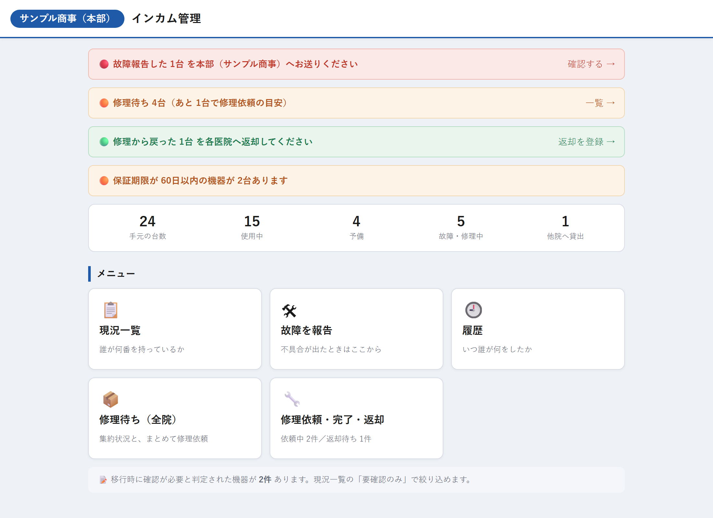
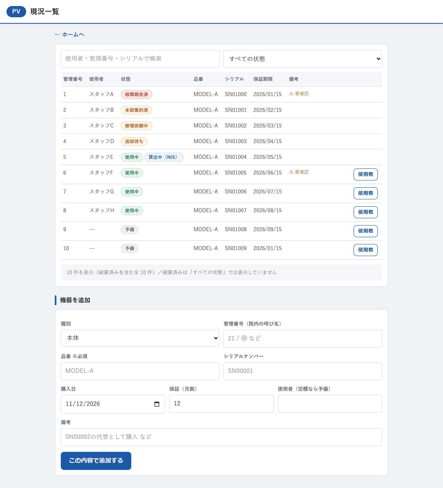
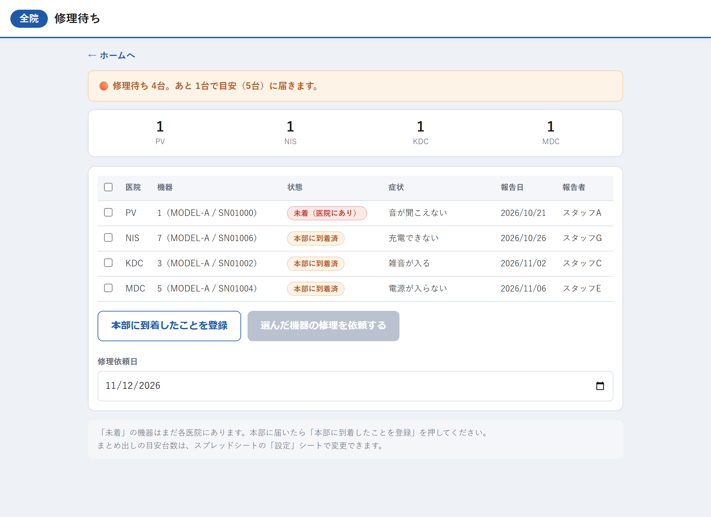
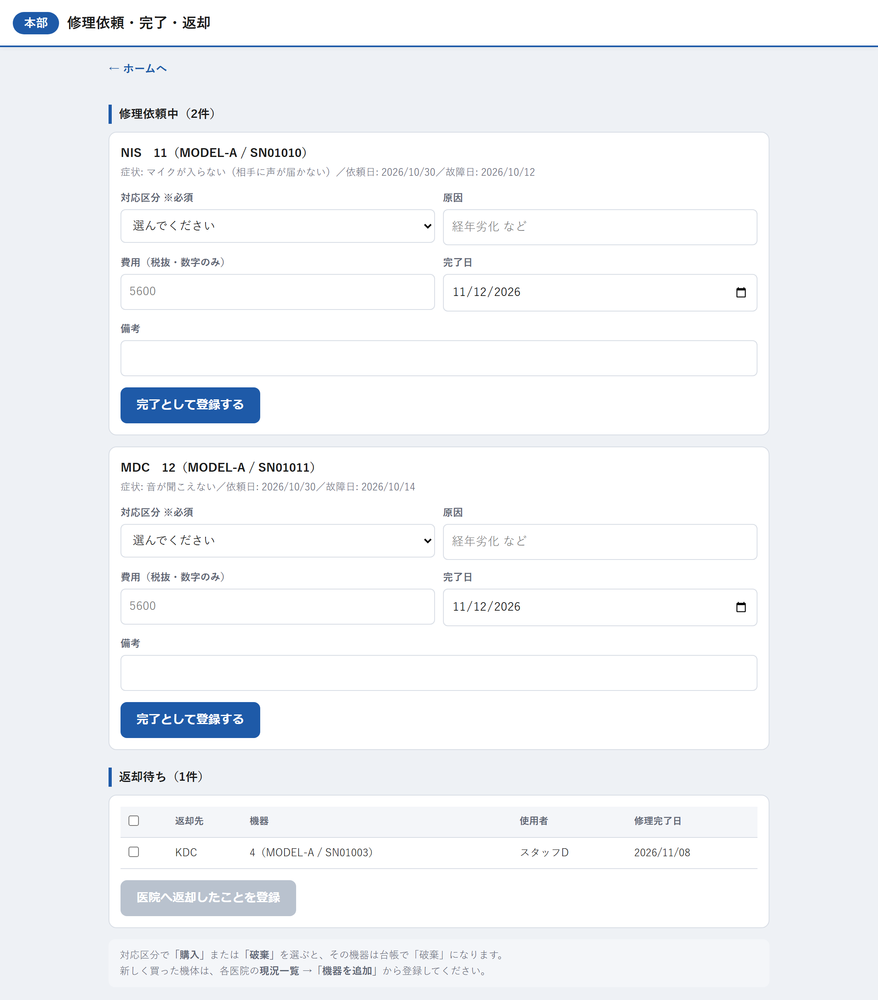
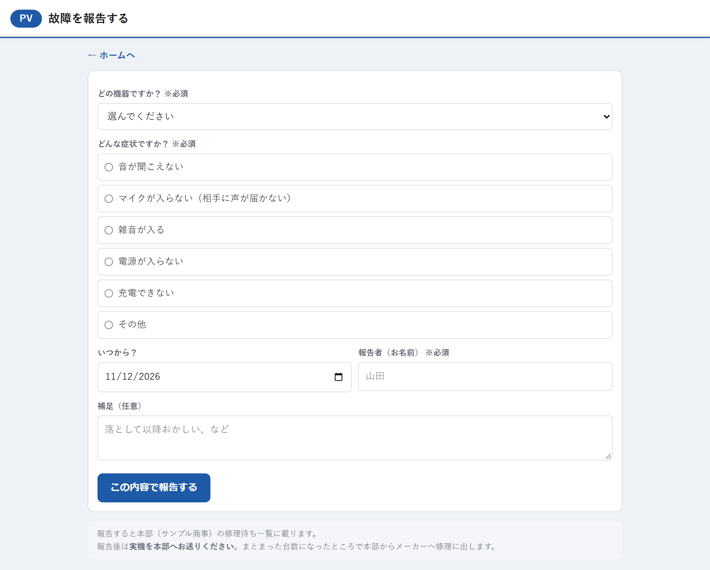
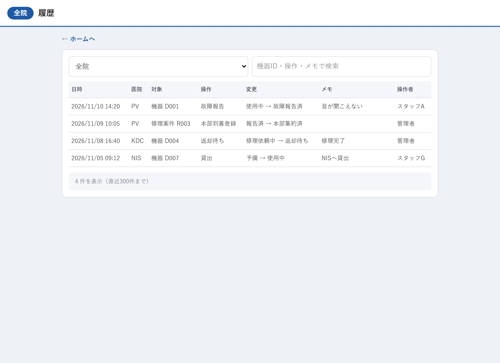

# インカム管理(機器台帳・修理管理)

複数医院で使うインカム(無線機)の **台帳管理と故障・修理の流れ** を一元化する Web アプリです。
従来は医院ごとのスプレッドシートに「備考欄の日本語」で状態を書いていたものを、状態の列挙とワークフローに置き換えました。
Google Apps Script + スプレッドシートで動作し、サーバー費用はかかりません。

> スクリーンショットはすべてダミーデータです(`mocks/` のデータで撮影)。

## 主な機能

- **現況一覧**: 誰がどの機器を使っているか、状態・保証期限・貸出/借用を一覧。故障中の機器を上に表示
- **故障報告**: 現場がスマホから報告 → 症状は選択式(表記ゆれによる集計不能を防ぐ)
- **修理待ち(全院)**: 各医院の故障機を本部に集約し、**目安台数に達したらまとめて修理依頼**(送料を抑える運用)
- **修理依頼・完了・返却**: 依頼 → 完了登録 → 各医院への返却までを状態遷移で管理
- **履歴**: いつ誰が何をしたかを操作ログとして自動記録
- **保証期限アラート**、**移行時の要確認フラグ**

## 画面

| ホーム(本部) | 現況一覧 |
|---|---|
|  |  |

| 修理待ち(全院) | 修理依頼・完了・返却 |
|---|---|
|  |  |

| 故障を報告 | 履歴 |
|---|---|
|  |  |

## 設計のポイント

- **状態を列挙で定義**(`config.js`): 使用中 / 予備 / 故障報告済 / 本部集約済 / 修理依頼中 / 返却待ち / 破棄。画面・集計・ログがすべて同じ定義を参照します。
- **既存シートは読み取り専用で残し、正規化した新シートへ移行**(`migration.js`): 旧データの揺れ(全角スペース、末尾の記号の有無など)を吸収する正規化処理を実装。
- **GAS の制約への対応**: `doGet` は 1 つしか持てないため、`router.js` で `?page=` によって画面を振り分けています。

## 構成

```
router.js          URL パラメータから画面を振り分け
config.js          医院・状態・シート名などの定義
devices.js         機器台帳     repair.js    修理ワークフロー
history.js         操作ログ     migration.js 旧シートからの移行
*.html             各画面
mocks/             スクリーンショット用のダミーデータ
```

## スクリーンショットの再取得

```bash
cd tools/gas-screenshots && npm install
node capture.mjs ../../サンプル商事/インカム整理/screenshots.config.json
```
