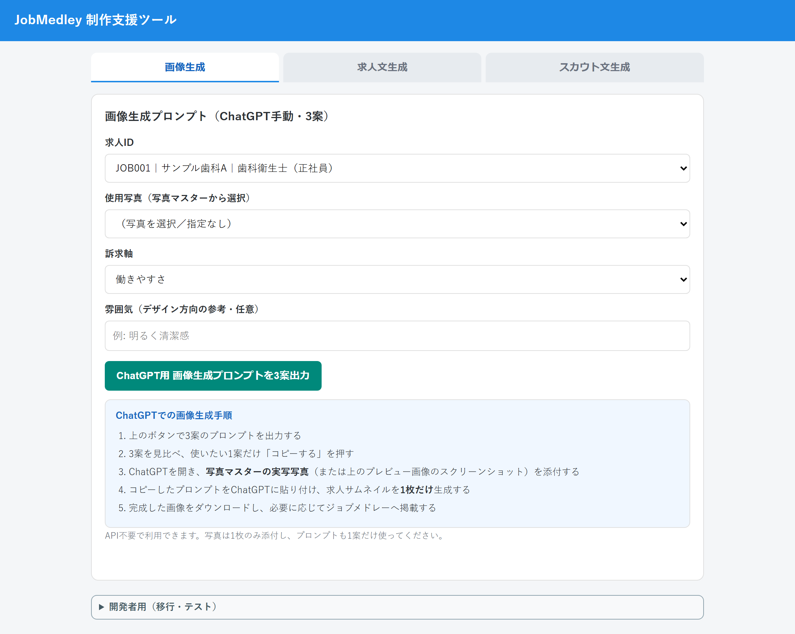
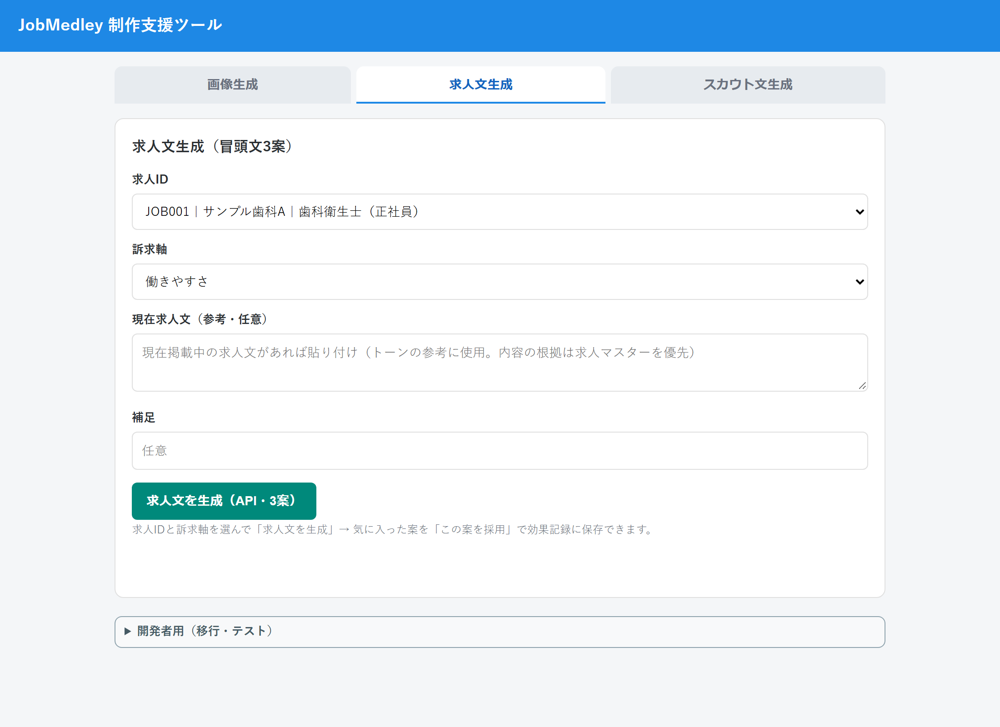
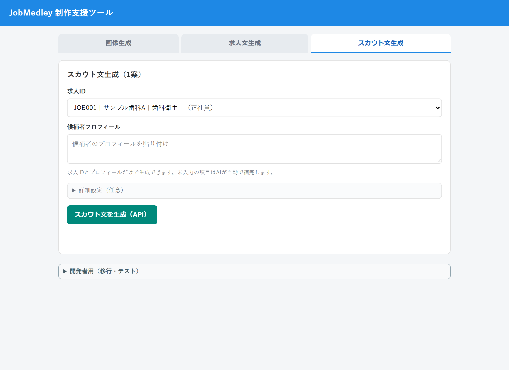

# 求人運用の制作支援ツール(JobMedley)

求人媒体に掲載する **サムネイル画像のプロンプト・求人文・スカウト文** を、求人マスターと過去の効果記録をもとに作る Web アプリです。
Google Apps Script + スプレッドシート + OpenAI API で動作します。

> スクリーンショットはダミーデータです(`mocks/` のデータで撮影)。

## 主な機能

| タブ | 内容 |
|---|---|
| 画像生成 | 求人・写真・訴求軸を選ぶと、ChatGPT 用の画像生成プロンプトを **3案** 出力 |
| 求人文生成 | 求人マスターを根拠に、冒頭文を **3案** 生成。気に入った案を「採用」すると効果記録に保存 |
| スカウト文生成 | 求人と訴求軸から、スカウト文を **1案** 生成 |



| 求人文生成 | スカウト文生成 |
|---|---|
|  |  |

## 設計のポイント

- **根拠は求人マスターを優先**: 生成文の内容は求人マスターの値に基づかせ、現在の求人文は「トーンの参考」に限定します(事実と異なる記載を防ぐため)。
- **採用した案を効果記録へ保存**: どの案を採用したかを残し、あとから効果を振り返れます。
- **API 不要でも使える**: 画像は ChatGPT に手動で貼る運用とし、API キーが無い環境でも利用できます。
- **秘密情報はコードに置かない**: `OPENAI_API_KEY` はスクリプトプロパティに設定します。
- **導入時の自己診断**: 「初期設定チェック」で、必要なシート・設定の不足を画面から確認できます。

導入手順は [docs/導入手順.md](docs/導入手順.md) を参照してください。

## 構成

```
コード.js        サーバー側(求人マスター参照、プロンプト生成、OpenAI 呼び出し、効果記録)
Index.html       画面(3 タブ)
mocks/           スクリーンショット用のダミーデータ
```

## スクリーンショットの再取得

```bash
cd tools/gas-screenshots && npm install
node capture.mjs ../../サンプル商事/ジョブメドレー/screenshots.config.json
```
