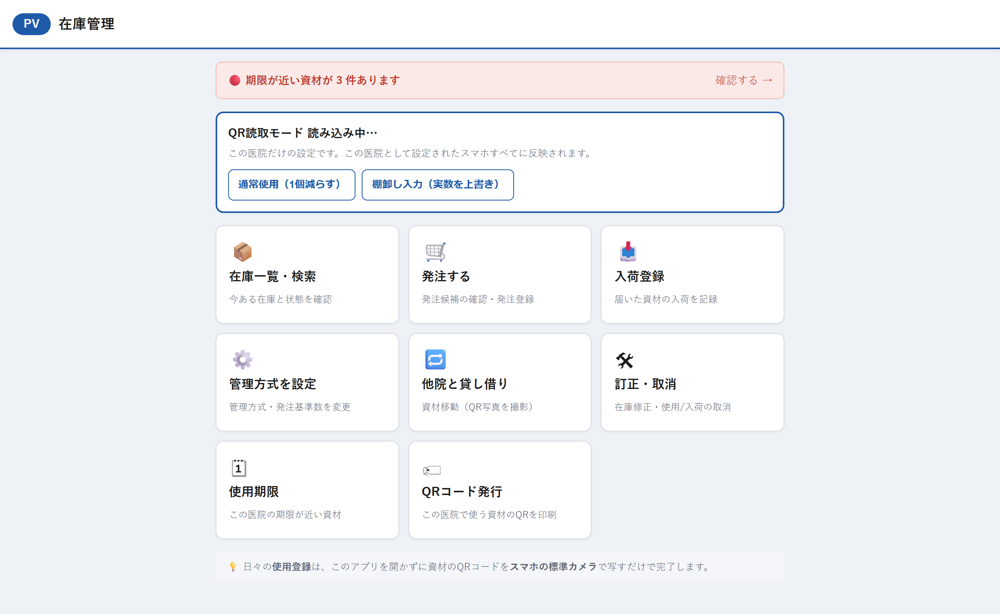
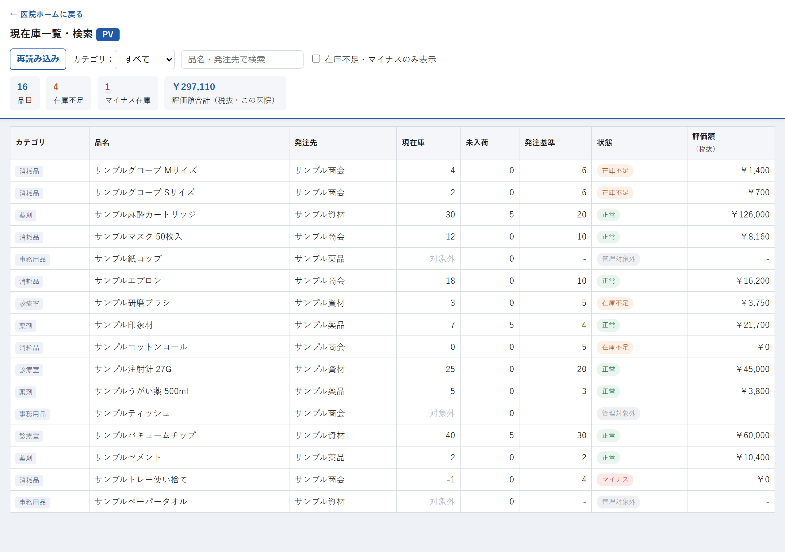
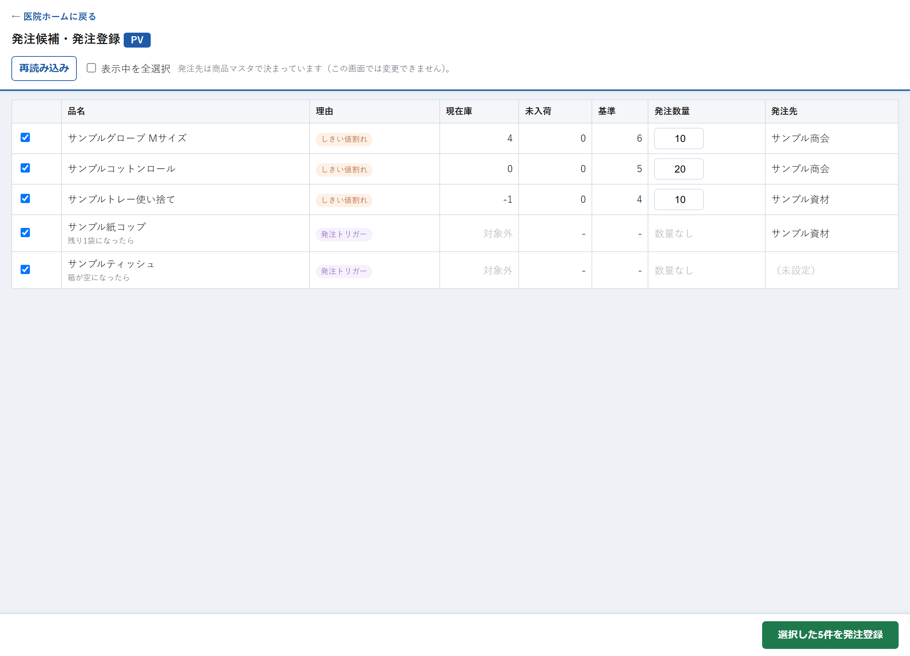
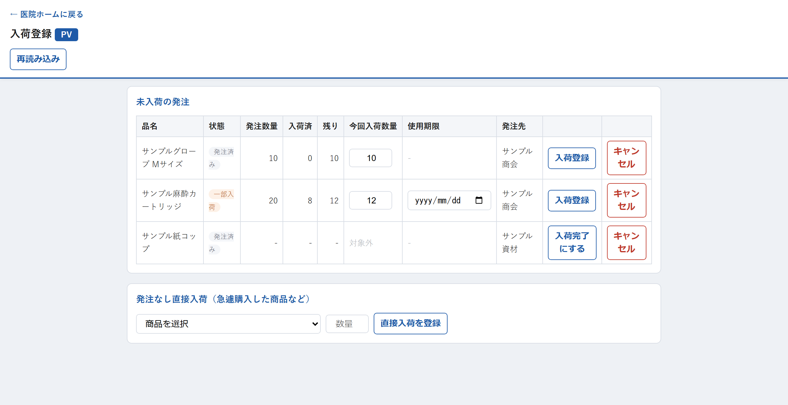
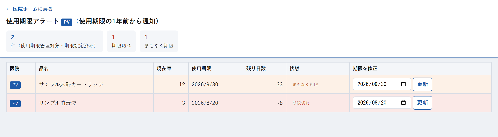
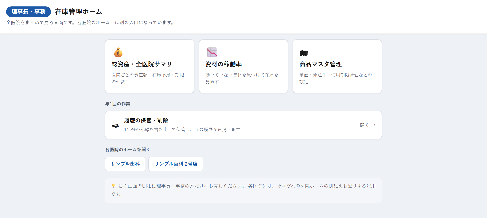
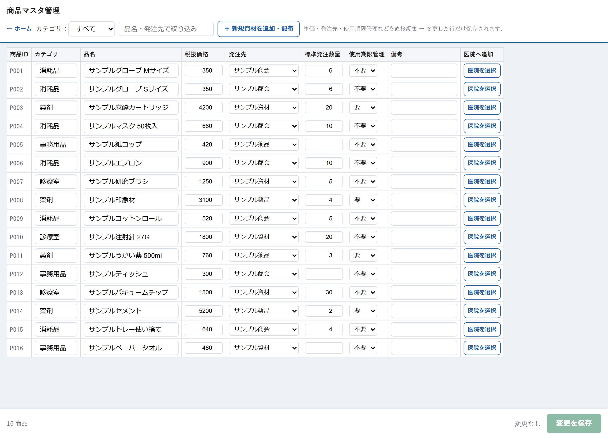

# 歯科医院向け 在庫・棚卸し管理システム

複数医院の資材在庫を、**QRコードとスマホだけ**で管理する Web アプリです。
Google Apps Script(GAS)+ スプレッドシートで動くため、サーバー費用がかかりません。

> スクリーンショットはすべてダミーデータです(`tools/manual/mocks/` のデータで撮影)。

## 主な機能

- **QR 読み取りで使用登録**: 資材のQRをスマホの標準カメラで読むだけで在庫が1減ります
- **在庫一覧・検索**: 在庫不足・マイナス在庫の自動判定、評価額の集計
- **発注候補・発注登録**: 基準数割れ/発注トリガーから候補を自動生成
- **入荷登録**: 発注に対する入荷(一部入荷にも対応)、使用期限の登録
- **使用期限アラート**: 期限の1年前から通知
- **医院間の貸し借り**、**在庫の訂正・取消**、**履歴の年次アーカイブ**
- **本部向け管理画面**: 全医院の総資産サマリ、資材の稼働率、商品マスタ管理

## 画面

| ホーム | 在庫一覧 |
|---|---|
|  |  |

| 発注候補 | 入荷登録 |
|---|---|
|  |  |

| 使用期限アラート | 本部ホーム |
|---|---|
|  |  |

| 商品マスタ管理 |
|---|
|  |

## 構成

```
*.js / *.html      GAS 本体(画面ごとに HTML + サーバー関数の JS)
router.js          URL パラメータから画面を振り分け
tools/manual/      利用者マニュアルの自動生成(Playwright でスクショ取得 + コード解析)
docs/manual/       生成したマニュアル
要件定義書_*.md     要件定義書
```

マニュアル自動生成は、スクリーンショットとコードから根拠を機械的に集め、
「実装に無いことを書かない」ことを狙った仕組みです(`tools/manual/README.md` 参照)。

## スクリーンショットの再取得

```bash
npm install
node tools/manual/capture.mjs --source=local   # ログイン不要、ダミーデータで撮影
```
