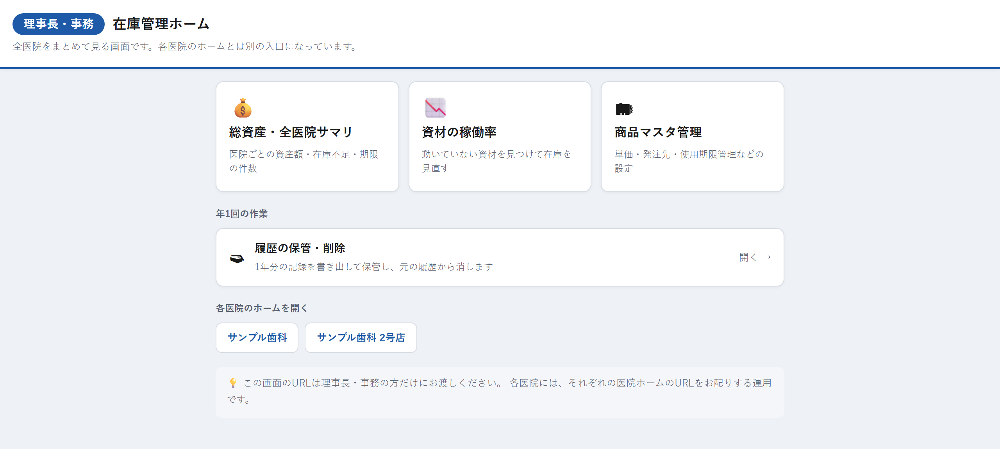

# 在庫管理ホーム（理事長・事務）

## この画面でできること

理事長・事務の方が使う入口の画面です。全医院をまとめて見るための3つの画面へ、ここから移動できます。

各医院のスタッフが使う「在庫管理ホーム」とは別の画面です。医院ごとの在庫を直接さわることはできません。

画面の下には各医院のホームへのボタンも並んでいるので、特定の医院の在庫を見たいときはそこから移動できます。

## 操作手順

1. 理事長・事務用のURLを開きます。
2. 見たい内容のカードを押します。
   - 医院ごとの資産額を見る → 「総資産・全医院サマリ」
   - 動いていない資材を探す → 「資材の稼働率」
   - 単価や発注先を直す → 「商品マスタ管理」
3. 移動した先の画面から戻るときは、その画面の「← 理事長・事務ホームへ戻る」を押します。

## 各項目の説明

### 上の3つのカード

| 項目 | 説明 |
| --- | --- |
| 💰 総資産・全医院サマリ | 医院ごとの資産額・在庫不足・期限の件数を見る画面へ移動します。 |
| 📉 資材の稼働率 | 動いていない資材を見つけて在庫の見直しに使う画面へ移動します。 |
| 🗂 商品マスタ管理 | 単価・発注先・使用期限管理などの設定をする画面へ移動します。 |

### 年1回の作業

| 項目 | 説明 |
| --- | --- |
| 🗃 履歴の保管・削除 | 1年分の記録を書き出して保管し、元の履歴から消す画面へ移動します。年に1回だけ使います。 |

### 各医院のホームを開く

| 項目 | 説明 |
| --- | --- |
| NIS／MDC／KDC／PV／訪問部 | そのボタンを押すと、その医院の在庫管理ホームへ移動します。 |

## 注意事項

- **この画面のURLは理事長・事務の方だけにお渡しください。** 各医院には、それぞれの医院ホームのURLを配る運用です。
- **この画面では在庫の登録や修正はできません。** 在庫をさわる操作は、各医院のホームから行ってください。
- 「医院一覧を取得できませんでした。」と表示されたときは、ページを再読み込みしてください。それでも直らない場合はシステム管理の担当者に連絡してください。

## よくある質問

**Q. 各医院のスタッフがこの画面を開くとどうなりますか？**

A. URLを知っていれば開けてしまいます。全医院の金額が見える画面なので、URLは理事長・事務の方だけにお渡しください。

**Q. 「履歴の保管・削除」は毎月やるものですか？**

A. 年に1回だけの作業です。詳しくは「履歴の保管・削除」の画面の説明をご覧ください。

**Q. 医院のボタンを押したあと、この画面に戻るには？**

A. 医院のホームからは直接戻れません。ブラウザの「戻る」を押すか、理事長・事務用のURLをもう一度開いてください。

---

[← 画面一覧に戻る](../index.md)
