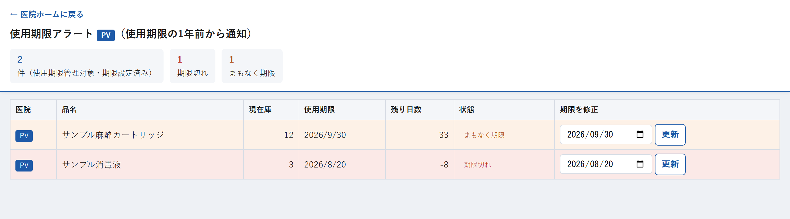

# 使用期限アラート

※ この例は、対象の資材が1件も無いときの表示です。

## この画面でできること

使用期限が近づいている資材や、期限が切れてしまった資材を確認する画面です。**使用期限の1年前から**表示されます。

期限の日付が実物と違っているときは、この画面で直すこともできます。

一覧に出てくるのは、商品マスタで「使用期限管理＝要」に設定されていて、かつ期限の日付が入っている資材だけです。

## 操作手順

### 期限が近い資材を確認する

1. 医院ホームの「🗓 使用期限」を押します。
2. 一覧が表示されます。期限が近い順（切れているものが上）に並びます。
3. 見出しに、開いた医院名が表示されていることを確認します。

### 期限の日付を直す

1. 直したい資材の行の「期限を修正」の欄で、正しい日付を選びます。
2. 同じ行の「更新」を押します。
3. 「使用期限を更新します。よろしいですか？」で「OK」を押します。

## 各項目の説明

| 項目 | 説明 |
| --- | --- |
| 医院名（見出しの青い表示） | 医院ホームから開いた医院です。この画面では変更できません。 |
| ◯件（使用期限管理対象・期限設定済み） | 表示されている資材の件数です。 |
| 期限切れ | 使用期限を過ぎている資材の件数です。 |
| まもなく期限 | 期限まで1年以内になっている資材の件数です。 |
| 医院 | その資材がある医院です。 |
| 品名 | 資材の名前です。 |
| 現在庫 | 今ある数です。 |
| 使用期限 | 登録されている期限の日付です。 |
| 残り日数 | 今日から期限までの日数です。マイナスの数は、期限を過ぎた日数を表します。 |
| 状態 | 「期限切れ」＝期限を過ぎている、「まもなく期限」＝期限まで1年以内、「通常」＝それより先、という意味です。 |
| 期限を修正 | 正しい期限の日付を入れる欄です。 |
| 更新 | 入力した日付で期限を上書きします。 |

## 注意事項

- **この画面に出るのは、使用期限を管理する設定になっている資材だけです。** すべての資材の期限を管理しているわけではありません。
- 医院ホームの期限件数と、この画面の一覧は、同じ医院・同じ「使用期限まで365日以内」の条件で表示されます。
- 読み込みが30秒以内に終わらない場合は「読み込みに時間がかかっています。医院ホームに戻って、もう一度開いてください。」と表示されます。
- 「高速表示用シートの初期設定が完了していません。管理者がApps Scriptで「installReadModelMaintenanceTrigger」を1回実行してください。」と表示された場合は、システム管理の担当者に連絡してください。
- **期限は資材ごとに1つだけ記録されます。** ロット（箱）ごとには管理していません。**いちばん近い期限**を入れる運用にしてください。
- **「更新」を押すと、入力した日付でそのまま上書きされます。** 入荷登録のときのような「早いほうだけ残す」動きはしません。日付をよく確認してから押してください。
- 期限の欄を空にして「更新」を押すと、その資材の期限は登録なしの状態に戻ります。
- 「医院別在庫に「使用期限」列がありません。②を再実行してください。」と表示された場合は、現場では対応できません。システム管理の担当者に連絡してください。

## よくある質問

**Q. 一覧に何も出てきません。**

A. 「対象商品がありません（使用期限管理＝要の商品で、期限が設定されているものが表示されます）。」と出ている場合は、期限を管理する設定の資材が無いか、期限の日付がまだ入っていない状態です。期限は「入荷登録」画面で入荷を記録するときに入力できます。

**Q. 期限まで半年以上あるのに一覧に出てきます。**

A. この画面は使用期限の1年前から表示する仕組みです。すぐに使い切れない場合の準備期間として、早めに表示しています。

**Q. 実際の箱の期限と表示が違います。**

A. 「期限を修正」の欄に正しい日付を入れて「更新」を押してください。複数の箱があるときは、いちばん近い期限を入れてください。

**Q. 期限切れの資材はどうすればよいですか？**

A. システム上の処理は決まっていません。医院の運用ルールに従って処分し、在庫の数が変わった場合は「訂正・取消」画面で数を直してください。

---

[← 画面一覧に戻る](../index.md)
