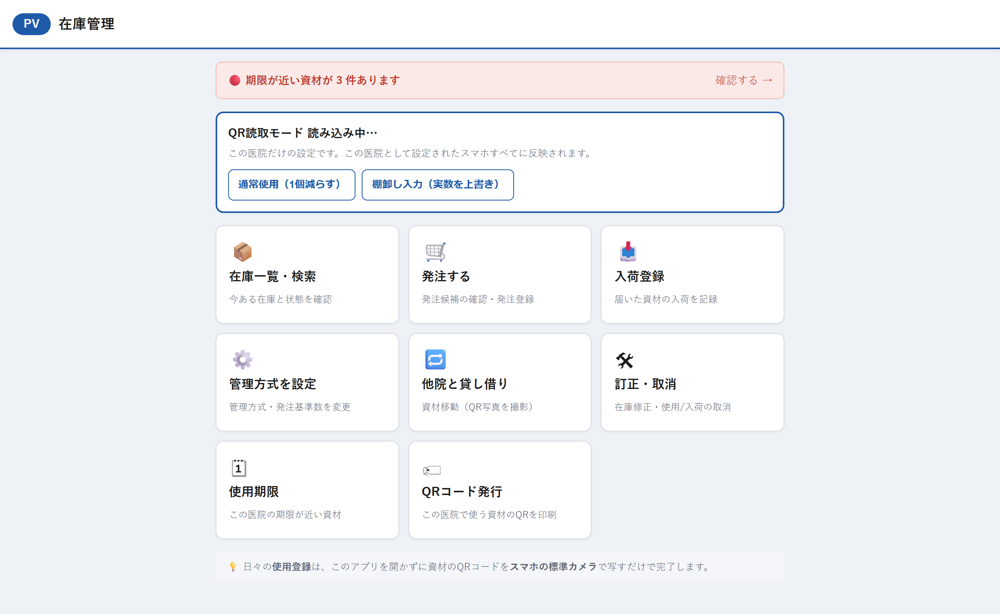

# 在庫管理ホーム

## この画面でできること

在庫管理システムの入口となる画面です。やりたいことのボタン（タイル）を押すと、それぞれの画面に移動できます。

画面の左上には、いま使っている医院の記号（例：`PV`）が表示されます。この記号が自分の医院になっているか、必ず確認してから使ってください。

使用期限が近い資材があるときは、タイルの上に赤い帯で「🔴 期限が近い資材が ◯件あります」と表示されます。

「QR読取モード」で、この医院のQRを「通常使用」に使うか「棚卸し入力」に使うかを切り替えられます。この設定は表示中の医院だけに反映されます。

## 操作手順

1. 医院ごとに配られた専用のURLを開きます。
2. 左上に自分の医院の記号が表示されていることを確認します。
3. やりたいことのタイルを押します。
4. 用事が終わったら、それぞれの画面にある「← 医院ホームに戻る」でこの画面に戻れます。

### QR読取モードを切り替える

1. 「QR読取モード」に表示されている現在のモードを確認します。
2. 普段の運用では「通常使用（1個減らす）」を押します。
3. 棚卸しを行うときは「棚卸し入力（実数を上書き）」を押します。
4. 医院名・変更後の動作・全スマホへ反映される案内を確認します。
5. 「OK」を押します。

医院の記号が付いていないURLで開くと、「医院を選択してください」という画面になり、医院を選ぶボタンが並びます。自分の医院のボタンを押すと、この画面に進みます。

## 各項目の説明

| 項目 | 説明 |
| --- | --- |
| 🔴 期限が近い資材が ◯件あります | 使用期限が近い、または過ぎている資材の件数です。押すと「使用期限」の画面に移動します。0件のときは表示されません。 |
| QR読取モード | この医院のスマホでQRを読んだときの動作を表示します。 |
| 通常使用（1個減らす） | 数量管理商品は、確認ボタンを押すと在庫を1個減らすモードです。 |
| 棚卸し入力（実数を上書き） | 数えた実数を入力して、その商品の現在庫を上書きするモードです。 |
| 📦 在庫一覧・検索 | 今ある在庫と状態を確認します。 |
| 🛒 発注する | 発注候補の確認・発注登録をします。 |
| 📥 入荷登録 | 届いた資材の入荷を記録します。 |
| ⚙️ 管理方式を設定 | 管理方式・発注基準数を変更します。 |
| 🔁 他院と貸し借り | QR写真を撮影して資材を移動する画面に移動します。 |
| 🛠 訂正・取消 | 在庫修正・使用/入荷の取消をします。 |
| 🗓 使用期限 | この医院の期限が近い資材を確認します。 |
| 🏷 QRコード発行 | この医院で使う資材のQRを印刷します。 |

画面の一番下には「💡 日々の**使用登録**は、このアプリを開かずに資材のQRコードを**スマホの標準カメラ**で写すだけで完了します。」という案内が出ています。

## 注意事項

- **左上の医院の記号を必ず確認してください。** この画面で開いた医院が、次に開く画面にもそのまま引き継がれます。別の医院のURLを開いてしまうと、その医院のデータを操作することになります。
- QR読取モードの変更は、この医院として設定されたすべてのスマホに反映されます。他医院のモードは変更しません。
- 棚卸しが終わったら「通常使用（1個減らす）」へ戻してください。棚卸し入力のままだと、QRを読んだ際に使用登録ではなく実数入力画面が開きます。
- **「一斉在庫登録（棚卸し）」のタイルはこの画面にはありません。** 棚卸しの日に配られる専用のURLから開いてください。
- 期限の帯（🔴）が出ていない場合でも、期限が近い資材が無いというだけで、画面が壊れているわけではありません。
- 医院の記号が正しくないURLを開くと、「読み込みに失敗しました：不明な医院: ◯◯」と表示されます。配られたURLをそのまま開いてください。

## よくある質問

**Q. 「医院を選択してください」と表示され、ボタンが並んでいます。**

A. 医院の記号が付いていないURLで開いたときの画面です。自分の医院のボタンを押せば先に進めます。次回からは、医院ごとに配られた専用のURLを開いてください。

**Q. タイルを押しても何も起きません。**

A. 通信が終わるまで少し時間がかかることがあります。数秒待っても変わらないときは、ページを再読み込みしてから、もう一度押してください。

**Q. 毎日の「使用した」記録はどこで行いますか？**

A. この画面を開く必要はありません。資材に貼ってあるQRコードを、スマホの標準のカメラで写すだけで登録できます。詳しくは[使用登録（QR読み取り）](useinstant.md)を見てください。

**Q. PVを棚卸し入力にすると、他の医院も切り替わりますか？**

A. 切り替わりません。QR読取モードは医院ごとに保存されます。

**Q. 赤い帯の件数は何を数えていますか？**

A. この医院の資材のうち、使用期限が切れているもの、または期限が近づいているものの件数です。押すと一覧が確認できます。

---

[← 画面一覧に戻る](../index.md)
