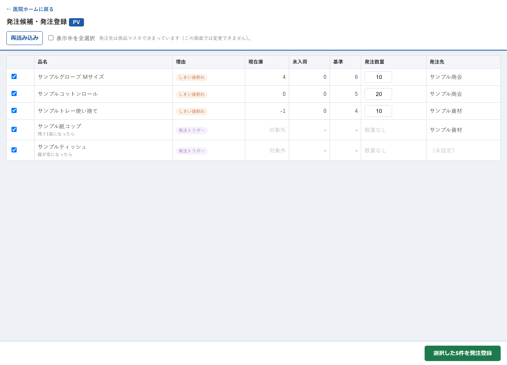

# 発注候補・発注登録

## この画面でできること

在庫が少なくなった資材を自動でリストアップしてくれる画面です。そのリストから発注するものを選び、数量を入れて「発注した」と記録します。発注先は商品マスタで決まっているので、この画面では選びません。

記録しても**現在庫の数は変わりません。** 「これから届く数（未入荷）」として記録され、実際に届いたときに「入荷登録」画面で在庫に反映します。

なお、この画面は発注書を送る機能ではありません。実際の注文（電話・FAX・メールなど）は、これまでどおりの方法で行ってください。

## 操作手順

1. 医院ホームの「🛒 発注する」を押します。
2. 発注が必要な資材の一覧が自動で表示されます。最初はすべてにチェックが入っています。
3. 今回発注しないものは、左のチェックを外します。
4. 「発注数量」に注文する数を入れます。
5. 「発注先」の列に、その資材の発注先が表示されます（この画面では変更できません）。
6. 画面の右下にある緑色の「選択した◯件を発注登録」を押します。
7. 「◯件を発注登録します。よろしいですか？」で「OK」を押します。
8. 「◯件 発注登録しました。」と表示されれば完了です。

## 各項目の説明

### 画面の上の部分

| 項目 | 説明 |
| --- | --- |
| 医院名（見出しの青いラベル） | 今どの医院の発注を登録しているかを表します。医院ホームから開いた医院で固定され、この画面では変えられません。 |
| 再読み込み | 発注候補を読み込み直して表示します。 |
| 表示中を全選択 | 表示されている行のチェックを、まとめて入れたり外したりします。 |

### 一覧表

| 項目 | 説明 |
| --- | --- |
| チェックボックス（左端） | 今回発注するものにチェックを入れます。 |
| 品名 | 資材の名前です。 |
| 理由 | なぜ候補に挙がったかです。「在庫基準以下」＝（現在庫＋未入荷）が発注基準以下になった、「発注トリガー」＝使用登録のときに発注候補へ入った、という意味です。 |
| 現在庫 | 今ある数です。 |
| 未入荷 | すでに発注していて、まだ届いていない数です。 |
| 基準 | 発注基準の数です。 |
| 発注数量 | 注文する数を入れます。1以上の数を入れてください。商品マスタに「標準発注数量」が登録されていれば、最初から入っています。 |
| 発注先 | 商品マスタに登録されている発注先が表示されます。この画面では変更できません。「（未設定）」と出る資材は、「商品マスタ管理」画面で発注先を登録してください。 |
| 選択した◯件を発注登録（右下の緑ボタン） | チェックを入れた資材をまとめて発注登録します。件数はチェックの数に合わせて変わります。 |

在庫の数を数えない資材（発注トリガー管理）は、発注数量の欄が「数量なし」と表示され、数を入れる必要はありません。

## 注意事項

- **発注登録をしても現在庫は増えません。** 増えるのは「未入荷」の数です。実際に届いたら「入荷登録」画面で登録してください。
- **チェックを入れた資材のうち、発注数量が空のものがあると登録できません。** 「発注数量が未入力の商品があります：◯◯」と表示されるので、数を入れてから登録し直してください。
- **同じ内容を続けて登録しても、二重には登録されません。** その場合は「この登録は送信済みです（二重登録を防止しました）。」と表示されます。
- **登録した発注を取りやめるときは「入荷登録」画面の「キャンセル」を使います。** この画面からは取り消せません。
- 「発注が必要な商品はありません。」と表示されるのは、発注基準を下回っている資材が無い状態です。
- 発注基準を設定していない資材は、在庫が少なくてもこの一覧には出てきません。基準は「管理方式を設定」画面で登録します。

## よくある質問

**Q. 発注したい資材が一覧に出てきません。**

A. この一覧に出るのは「（現在庫＋未入荷）が発注基準以下になった資材」と「使用登録で発注候補に入った資材」だけです。それ以外の資材を発注したいときは、発注基準を見直すか、届いたときに「入荷登録」画面の「発注なし直接入荷」で記録してください。

**Q. 「発注先」が「（未設定）」になっています。／発注先を変えたいです。**

A. 発注先は資材ごとに商品マスタで決まっており、医院側では変更できません。理事長・事務の「商品マスタ管理」画面で、その資材の発注先を設定・変更してください。

**Q. 発注数量を間違えて登録しました。**

A. 「入荷登録」画面でその発注を「キャンセル」してから、この画面で登録し直してください。

**Q. 「在庫基準以下」と出ていますが、在庫はまだあります。**

A. 判定には「未入荷」の数も含めた合計（現在庫＋未入荷）を使い、それが発注基準以下かどうかで判断しています。基準の数が実態に合っていないときは、「管理方式を設定」画面で見直してください。

---

[← 画面一覧に戻る](../index.md)
