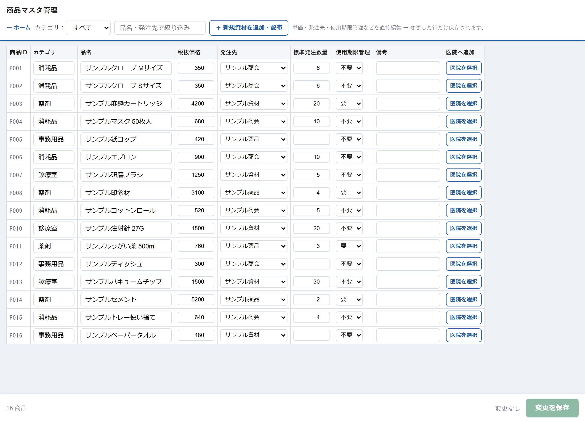

# 商品マスタ管理

## この画面でできること

すべての資材の基本情報（税抜価格・発注先・標準発注数量・使用期限管理・備考）をまとめて管理する画面です。表の中を直接書き換えて、**変更した行だけ**を保存します。

また、「＋ 新規資材を追加・配布」から新しい資材を登録し、使う医院を選んで一度に配布することもできます。

商品マスタにすでにある資材は、一覧の「医院を選択」からPVなどの医院へ追加できます。商品情報をもう一度入力する必要はありません。

ここで登録した内容は、発注や在庫一覧など他の画面にも反映されます。

## 操作手順

### 資材の情報を直す

1. 「在庫管理ホーム（理事長・事務）」から「商品マスタ管理」を押します。
2. 「カテゴリ」や「品名・発注先で絞り込み」で直したい資材を探します。
3. 表の中の欄をそのまま書き換えます。
4. 右下の「変更を保存」を押します。
5. 「変更した◯商品を保存します。よろしいですか？」で「OK」を押します。

### 新しい資材を追加して配布する

1. 「＋ 新規資材を追加・配布」を押します。
2. 「品名（必須）」を入力します。カテゴリ・税抜価格・発注先・標準発注数量・使用期限管理・備考は必要に応じて入力します。
3. 「配布先医院（1院以上選択）」で、その資材を使う医院にチェックを入れます。
4. 「追加して配布する」を押します。

### 既存の資材をPVなどの医院へ追加する

1. 「カテゴリ」または「品名・発注先で絞り込み」で、追加したい資材を探します。
2. 該当商品の右端にある「医院を選択」を押します。
3. 「追加先医院」で「PV」など、使用する医院にチェックを入れます。
4. 「選択した医院へ追加」を押します。
5. 「PVへ追加しました。」と表示されたら完了です。
6. 追加先医院の「管理方式を設定」画面で、管理方式と発注基準を設定します。

## 各項目の説明

### 画面の上の部分

| 項目 | 説明 |
| --- | --- |
| ← ホーム | 「在庫管理ホーム（理事長・事務）」へ戻ります。 |
| カテゴリ | 資材の種類でしぼり込みます。 |
| 品名・発注先で絞り込み | 入れた文字を含む資材だけを表示します。 |
| ＋ 新規資材を追加・配布 | 新しい資材を登録する入力欄を開きます。 |
| ◯商品 | 表示している資材の件数です。 |
| 変更を保存 | 書き換えた行だけを保存します。 |

### 一覧表

| 項目 | 説明 |
| --- | --- |
| 商品ID | システムが自動で付ける番号です（例：P0001）。変更できません。QRコードにもこの番号が使われます。 |
| カテゴリ | 資材の種類です。 |
| 品名 | 資材の名前です。 |
| 税抜価格 | 在庫の金額を計算するときに使う単価（税抜）です。0以上の数を入れます。資産評価額はこの単価で計算されます。 |
| 発注先 | 発注先を選びます。一覧に無い場合は「その他（自由入力）」を選ぶと入力欄が出ます。ここで入力した発注先は、次に画面を開いたときから一覧の選択肢に並びます。各医院の発注画面には、ここで設定した発注先がそのまま表示されます（医院側では変更できません）。 |
| 標準発注数量 | 発注画面で最初から入っている数量です。0以上の数を入れます。 |
| 使用期限管理 | 「要」にすると、入荷登録のときに期限の入力欄が出て、使用期限アラートの対象になります。「不要」なら期限は扱いません。 |
| 備考 | 自由に書けるメモ欄です。 |
| 医院を選択 | 既存の商品IDを変えずに、選択した医院の在庫へ追加する欄を開きます。 |

### 既存商品を医院へ追加する欄

| 項目 | 説明 |
| --- | --- |
| 追加先医院（1院以上選択） | この商品を使用する医院にチェックを入れます。 |
| 選択した医院へ追加 | 商品マスタは変更せず、選択した医院の「医院別在庫」へ追加します。 |
| 閉じる | 医院への追加欄を閉じます。 |

### 新規追加の入力欄

| 項目 | 説明 |
| --- | --- |
| カテゴリ | 任意で入力します。 |
| 発注先 | 登録済みの発注先から選びます。一覧に無いときは「その他（自由入力）」を選んで入力します。 |
| 品名（必須） | 必ず入力してください。 |
| 税抜価格／標準発注数量 | 任意です。0以上の数を入れます。 |
| 使用期限管理 | 「不要」または「要」から選びます。 |
| 備考 | 任意のメモです。 |
| 配布先医院（1院以上選択） | その資材を使う医院にチェックを入れます。最低1つ必要です。 |
| 追加して配布する | 資材を登録し、選んだ医院の在庫に追加します。 |

## 注意事項

- **この画面の変更はすべての医院に影響します。** 単価や発注先を直すと、どの医院の表示も変わります。
- **書き換えただけでは保存されません。** 必ず「変更を保存」を押してください。
- **税抜価格と標準発注数量は0以上の数値だけです。** それ以外だと「税抜価格・標準発注数量は0以上の数値で入力してください。」と表示されます。
- **品名を空にして保存することはできません。** 「品名は必須です。」と表示されます。
- **新規追加では配布先医院を1つ以上選んでください。** 選ばないと「配布先医院を1院以上選んでください。」と表示されます。
- **既存商品の医院追加でも追加先医院を1つ以上選んでください。** 選ばないと「追加先医院を1院以上選んでください。」と表示されます。
- すでにその医院へ追加済みの商品は重複登録されません。「選択した医院には追加済みです。」と表示されます。
- 新しく追加した資材は、それぞれの医院で「管理方式を設定」画面から管理方式を決めるまで、在庫の増減や発注候補の対象になりません。
- 商品IDは変更できません。すでに印刷したQRコードはそのまま使えます。

## よくある質問

**Q. 同じ資材を2回登録してしまいました。**

A. この画面から資材を削除することはできません。使わないほうの資材は、各医院の「管理方式を設定」画面で「取り扱いなし」にしてください。

**Q. 発注先の一覧に取引先が出てきません。**

A. 「その他（自由入力）」を選ぶと、右に入力欄が出て自由に入力できます。入力して保存すると、次に画面を開いたときから一覧の選択肢に並びます。

**Q. 「使用期限管理」を「要」にしましたが、使用期限アラートに出てきません。**

A. 期限の日付がまだ登録されていないためです。入荷登録のときに期限を入力すると表示されるようになります。

**Q. 新しく追加した資材が、在庫一覧に出てきません。**

A. 配布先の医院にチェックを入れたか確認してください。追加されている場合は、その医院の在庫一覧に管理方式が未設定の状態で並びます。

**Q. 商品マスタにある資材をPVでも使うことになりました。**

A. 商品を検索し、右端の「医院を選択」を押してください。「PV」にチェックを入れて「選択した医院へ追加」を押します。商品を新規登録し直す必要はありません。

**Q. 追加した資材のQRコードはどこで印刷できますか？**

A. 「QRコード生成（印刷用）」画面から印刷できます。

---

[← 画面一覧に戻る](../index.md)
