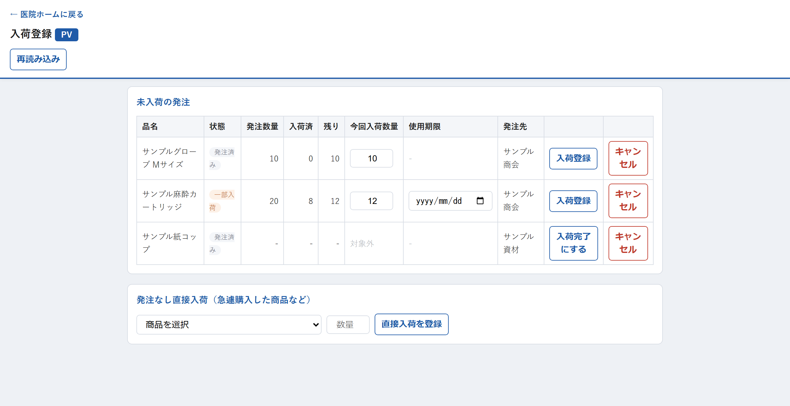

# 入荷登録

※ この例は、まだ届いていない発注が1件も無いときの表示です。発注が残っているときは「未入荷の発注」に一覧表が並びます。

## この画面でできること

発注した資材が医院に届いたときに、「届きました」と記録する画面です。

記録すると、その分だけ在庫の数が自動で増えます。手で在庫の数を数え直す必要はありません。

発注していない資材を急に買ってきた場合も、この画面の下側にある「発注なし直接入荷」から記録できます。

「未入荷の発注」と「発注なし直接入荷の商品一覧」は別々に読み込まれます。未入荷の発注が先に表示された場合は、そのまま入荷登録を始められます。

## 操作手順

### 発注した資材が届いたとき

1. 医院ホームの「📥 入荷登録」を押すと、まだ届いていない発注の一覧が自動で表示されます。
2. 届いた資材の行を探します。
3. 「今回入荷数量」に、**実際に届いた数**を入れます。最初から「残り」の数が入っているので、全部届いたときはそのままで大丈夫です。
4. 使用期限を管理している資材は、「使用期限」に箱に書かれている期限の日付を入れます。
5. その行の「入荷登録」を押します。
6. 「入荷登録します（数量：〇〇）。よろしいですか？」と聞かれるので「OK」を押します。
7. 画面の下に「入荷登録しました（在庫 〇 → 〇）」と表示されれば完了です。

### 発注していない資材が届いたとき（急に買ってきた場合など）

1. 「発注なし直接入荷（急遽購入した商品など）」の欄で、資材を選びます。
2. 「数量」に届いた数を入れます。
3. 使用期限を管理している資材のときは、「使用期限」の欄が出てくるので日付を入れます。
4. 「直接入荷を登録」を押し、確認の表示で「OK」を押します。

### 発注そのものを取りやめるとき

1. 取りやめたい発注の行の「キャンセル」を押します。
2. 「キャンセル理由を入力してください（任意）：」と出ます。理由を入れて「OK」を押します（何も入れなくてもかまいません）。
3. 「この発注をキャンセルします。未入荷分は取り消されます。よろしいですか？」で「OK」を押します。

## 各項目の説明

### 画面の上の部分

| 項目 | 説明 |
| --- | --- |
| 医院名（見出しの青いラベル） | 今どの医院の入荷を登録しているかを表します。医院ホームから開いた医院で固定され、この画面では変えられません。 |
| 再読み込み | 「まだ届いていない発注」を読み込み直して表示します。 |
| ← 医院ホームに戻る | 在庫管理ホームの画面に戻ります。 |

### 「未入荷の発注」の表

| 項目 | 説明 |
| --- | --- |
| 品名 | 発注した資材の名前です。 |
| 状態 | 「発注済み」＝まだ1つも届いていない、「一部入荷」＝一部だけ届いている、を表します。 |
| 発注数量 | 発注したときの数です。 |
| 入荷済 | これまでに届いたと記録した数です。 |
| 残り | まだ届いていない数（発注数量 − 入荷済）です。 |
| 今回入荷数量 | 今回届いた数を入れる欄です。最初は「残り」の数が入っています。入れられるのは1以上、「残り」の数まで（1きざみ）です。 |
| 使用期限 | 使用期限を管理している資材だけ、日付を入れる欄が出ます。管理していない資材は「-」と表示され、入力できません。 |
| 発注先 | どこに発注したかが表示されます。 |
| 入荷登録 | この行の入荷を登録するボタンです。 |
| キャンセル | この発注そのものを取りやめるボタンです。まだ届いていない分が取り消されます。 |

> 「今回入荷数量」が「対象外」、ボタンが「入荷完了にする」になっている行があります。
> これは在庫の数を数えない管理方法（発注トリガー管理）の資材です。数を入れる必要はなく、
> ボタンを押すと「届いた」という記録だけが残ります。在庫の数は変わりません。

### 「発注なし直接入荷」の欄

| 項目 | 説明 |
| --- | --- |
| 商品を選択 | 資材を選びます。かっこの中は、いま登録されている在庫の数です。ここに出てくるのは在庫の数を数えて管理している資材だけです。 |
| 数量 | 届いた数を入れます。1以上の数を入れてください。 |
| 使用期限 | 使用期限を管理している資材を選んだときだけ表示されます。 |
| 直接入荷を登録 | 選んだ内容で入荷を記録します。 |

## 注意事項

- **「残り」の数より多い数は登録できません。** 多く入れると「入荷数量が未入荷数量（〇〇）を超えています。」と表示されます。届いた数が発注した数より多いときは、まず「残り」の数まで登録し、超えた分は「発注なし直接入荷」で登録してください。
- **数量を空のままボタンを押すと「入荷数量を入力してください。」と表示されます。** 必ず1以上の数を入れてください。
- **一部だけ届いたときは、届いた数だけを入れてください。** 状態が「一部入荷」に変わり、残りの数は次に届いたときに登録できます。
- **見出しの医院名を確認してください。** 登録すると、そこに表示されている医院の在庫が増えます。別の医院で登録したいときは、その医院のホームから入り直してください。
- **使用期限は、いちばん近い日付だけが記録されます。** すでに登録されている期限より早い日付を入れたときだけ更新され、遅い日付を入れた場合は元の（より早い）期限が残ります。
- **間違えて登録してしまったときは、「訂正・取消」画面から取り消せます。** ただし、入荷を取り消すと在庫の数は戻りますが、**発注の状態（入荷済みなど）は自動では戻りません**。
- 発注を「キャンセル」すると、まだ届いていない分の記録が取り消されます。すでに届いたと登録した分はそのまま残ります。
- 読み込みが30秒以内に終わらない場合は「読み込みに時間がかかっています。\n「再読み込み」を押してください。」と表示されます。「再読み込み」を押してください。
- 「高速表示用シートの初期設定が完了していません。管理者がApps Scriptで「installReadModelMaintenanceTrigger」を1回実行してください。」と表示された場合は、システム管理の担当者に連絡してください。

## よくある質問

**Q. 発注した数と違う数が届きました。どうすればいいですか？**

A. 実際に届いた数を「今回入荷数量」に入れてください。少なかった場合は状態が「一部入荷」になり、残りは次に届いたときに登録できます。多かった場合は、まず「残り」の数まで登録し、超えた分は下の「発注なし直接入荷」で登録してください。

**Q. 「使用期限」の欄が出てくる資材と、出てこない資材があります。**

A. 使用期限を管理する設定になっている資材だけ、期限の入力欄が出ます。出ない資材は期限を記録しない設定なので、そのまま登録して問題ありません。

**Q. 「対象外」と表示されて数量が入れられません。**

A. その資材は在庫の数を数えずに管理しています（発注トリガー管理）。数量を入れる必要はありません。「入荷完了にする」を押せば記録は完了です。

**Q. 一覧に何も出てきません。**

A. 「未入荷の発注はありません。」と表示されている場合は、その医院にまだ届いていない発注が1件もない状態です。発注をしたのに出てこないときは、見出しの医院名が正しいか確認して、もう一度「再読み込み」を押してください。

**Q. 別の医院の入荷を登録したいです。**

A. この画面では医院を切り替えられません。その医院のホーム画面から「📥 入荷登録」を開き直してください。

---

[← 画面一覧に戻る](../index.md)
