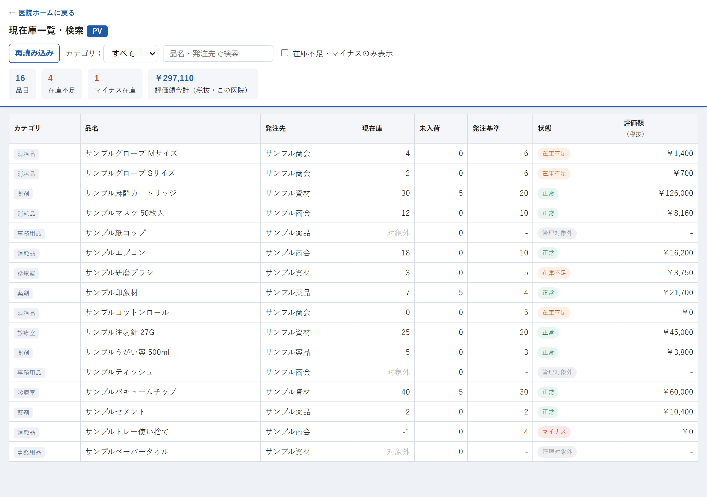

# 現在庫一覧・検索

## この画面でできること

いま自分の医院にある資材の一覧を見る画面です。数を登録したり減らしたりはしません。**見るだけ**の画面です。

資材ごとに「今いくつあるか」「足りていないか」が色付きの表示で分かります。品名や発注先で探したり、足りない資材だけを絞り込んで表示することもできます。

## 操作手順

1. 医院ホームの「📦 在庫一覧・検索」を押します。
2. 一覧が表示されます（資材の数が多いと少し時間がかかります）。
3. 特定の資材を探すときは、「品名・発注先で検索」の欄に品名や発注先の一部を入れます。
4. 種類でしぼるときは「カテゴリ」から選びます。
5. 足りない資材だけを見たいときは「在庫不足・マイナスのみ表示」にチェックを入れます。
6. 最新の数に更新したいときは「再読み込み」を押します。

## 各項目の説明

### 画面の上の部分

| 項目 | 説明 |
| --- | --- |
| 再読み込み | 最新の在庫数を取り直して表示します。 |
| カテゴリ | 資材の種類でしぼり込みます。最初は「すべて」です。 |
| 品名・発注先で検索 | 入れた文字が品名または発注先に含まれる資材だけを表示します。 |
| 在庫不足・マイナスのみ表示 | チェックを入れると、状態が「在庫不足」「マイナス」の資材だけを表示します。 |

### 集計の表示

| 項目 | 説明 |
| --- | --- |
| 品目 | この医院に登録されている資材の件数です。 |
| 在庫不足 | 状態が「在庫不足」の件数です。 |
| マイナス在庫 | 現在庫がマイナスになっている件数です。 |
| 評価額合計（この医院） | 各資材の「評価額」を合計した金額です。 |

### 一覧表

| 項目 | 説明 |
| --- | --- |
| カテゴリ | 資材の種類です。 |
| 品名 | 資材の名前です。 |
| 発注先 | その資材の発注先です。 |
| 現在庫 | 今ある数です。 |
| 未入荷 | 発注したけれど、まだ届いていない数です。 |
| 発注基準 | 「これ以下になったら発注する」という数です。設定していない資材は空欄になります。 |
| 状態 | 下の表を見てください。 |
| 評価額 | 税抜価格 × 現在庫 で計算した金額です。単価が登録されていない資材は ￥0 になります。 |

### 「状態」に出る言葉

| 表示 | 意味 |
| --- | --- |
| 正常 | 発注基準より在庫があります。 |
| 在庫不足 | （現在庫＋未入荷）が発注基準以下になっています。発注を検討してください。 |
| マイナス | 現在庫が0より少なくなっています。 |
| 管理対象外 | 在庫の数を数えない管理方法（発注トリガー管理）の資材です。この行は現在庫が「対象外」、評価額が「-」と表示されます。 |

## 注意事項

- **この画面では在庫の数を変更できません。** 数を直したいときは「訂正・取消」画面、棚卸しでまとめて入れ直すときは「一斉在庫登録」画面を使ってください。
- **「在庫不足」は、発注基準を設定している資材でしか判定されません。** 発注基準が空欄の資材は、在庫が0でも「在庫不足」にはなりません。
- **「未入荷」の数も含めて足りているかを判定します。** すでに発注済みで届いていない分があると、在庫が少なくても「在庫不足」にならないことがあります。
- 表示された数は、開いた（または「再読み込み」を押した）時点のものです。他の人が同時に登録すると変わるので、最新にしたいときは「再読み込み」を押してください。
- 医院ホームを経由せずに開くと、「医院が指定されていません。医院ホームから開いてください。」と表示されます。医院ホームから開き直してください。

## よくある質問

**Q. 探している資材が一覧に出てきません。**

A. まず「カテゴリ」が「すべて」になっているか、「在庫不足・マイナスのみ表示」のチェックが外れているかを確認してください。それでも出ない場合、その資材はこの医院の在庫に登録されていません。「商品マスタ管理」画面から追加できます。

**Q. 現在庫がマイナスになっています。**

A. 実際にあった数より多く「使用した」と登録されている状態です。棚卸しをして、「訂正・取消」画面か「一斉在庫登録」画面で正しい数に直してください。

**Q. 「評価額合計」が思っていた金額と違います。**

A. 評価額は「税抜価格 × 現在庫」で計算しています。商品マスタに税抜価格が登録されていない資材は ￥0 として数えるため、その分だけ少なくなります。

**Q. 「該当する商品がありません。」と出ました。**

A. 検索の文字やカテゴリの条件に合う資材が無いという意味です。検索欄を空にして、カテゴリを「すべて」に戻すと全件表示されます。

---

[← 画面一覧に戻る](../index.md)
