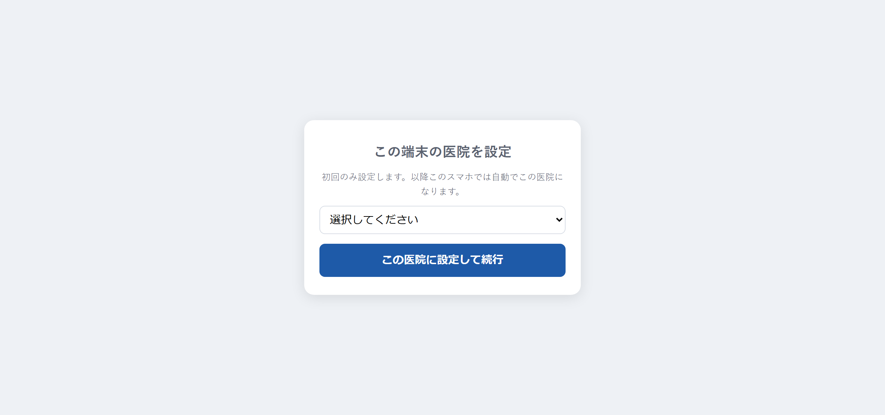

# 使用登録（QR読み取り）

## この画面でできること

資材のQRコードをスマホの標準カメラで読み取ります。端末に設定されている医院と、その医院ホームで選ばれた「QR読取モード」によって操作が変わります。

- **棚卸し入力**：数量管理商品の、数えた現在庫を入力して上書きします。
- **通常使用**：数量管理商品は1個の使用を登録します。発注トリガー管理商品は発注候補へ追加します。

QRのリンクを開いただけでは在庫は変わりません。画面の確定ボタンを押したときに更新されます。

## 操作手順

### はじめて使うとき（1回だけ）

1. 資材のQRコードをスマホの標準カメラで写します。
2. 画面に出てきたリンクを押します。
3. 「この端末の医院を設定」と表示されます。
4. プルダウンから自分の医院を選びます。
5. 「この医院に設定して続行」を押します。
6. 読み取った商品の確認画面へ進みます。

この設定は、そのスマホのブラウザに記憶されます。次回からは手順4・5は出てきません。「医院を変更する」を押した場合だけ選び直します。

### 棚卸し入力モードで現在庫を登録するとき

1. 資材のQRコードをスマホの標準カメラで写します。
2. 出てきたリンクを押します。
3. 画面上部が「医院名 棚卸し入力モード」になっていることを確認します。
4. 商品名と「システム上の現在庫」を確認します。
5. 数えた実数を入力します。在庫がない場合は「0」を入力します。
6. 「この数で現在庫を確定する」を押します。
7. 「現在庫を確定しました。」と表示されれば完了です。

### 通常使用モードで使用登録するとき

1. 資材のQRコードをスマホの標準カメラで写します。
2. 出てきたリンクを押します。
3. 商品名と現在庫を確認します。
4. 数量管理商品は「使用登録する（1個 減らす）」を押します。
5. 発注トリガー管理商品は「発注候補に追加する」を押します。
6. 完了表示を確認します。

## 各項目の説明

### 初回の設定画面

| 項目 | 説明 |
| --- | --- |
| 選択してください（プルダウン） | 自分の医院を選びます。 |
| この医院に設定して続行 | 選んだ医院をこのスマホに記憶して、使用登録を行います。 |

### 棚卸し入力画面

| 項目 | 説明 |
| --- | --- |
| 医院名 棚卸し入力モード | 表示中の医院で現在庫を登録する画面であることを示します。 |
| システム上の現在庫 | 登録前にシステムへ入っている在庫数です。 |
| 実数 | 実際に数えた現在庫を入力します。0以上の整数を入力します。 |
| この数で現在庫を確定する | 確認画面を挟まず、入力した数でその商品の現在庫を上書きします。 |
| 医院を変更する（共有端末の場合） | このスマホに記憶した医院を選び直します。 |

### 通常使用の確認・完了画面

| 表示 | 意味 |
| --- | --- |
| ✓ ＋ 品名 ＋「1個 使用しました」 | 登録できました。 |
| 在庫 ◯ → ◯ | 登録する前と後の在庫の数です。 |
| ／ 🛒 発注基準に達したため発注候補に追加しました | 発注基準の数まで減ったので、自動で発注候補に入りました。 |
| ⚠ ＋「（マイナスです）」 | 登録した結果、在庫が0より少なくなりました。 |
| 🛒 ＋「発注候補に追加しました。」 | 在庫の数を数えない資材のため、在庫は変えずに発注候補へ入れました。 |
| 🛒 ＋「すでに発注候補に入っています。」 | その資材はすでに発注候補に入っているため、何もしていません。 |
| ✓ 登録済み ＋「直前に登録しました（二重登録を防止）。」 | 同じ資材を続けて読み取ったため、二重登録を防いで何もしていません。 |
| 医院を変更する（共有端末の場合） | このスマホに記憶した医院を選び直します。 |

## 注意事項

- QRを開いただけでは在庫は変わりません。確定ボタンを押したときだけ更新されます。
- 棚卸し入力で登録した数は、追加・減算ではなく現在庫の上書きです。確認画面は出ないため、商品名と数を確認してから「この数で現在庫を確定する」を押してください。
- 棚卸し入力では数量管理商品だけ現在庫を入力できます。発注トリガー管理商品には「この資材は数量管理ではないため、現在庫を入力できません。」と表示されます。
- 通常使用の数量管理商品は、1回の使用登録で1個減ります。
- **共有のスマホで「医院を変更する」を押すときは注意してください。** 変更すると、次にそのスマホでQRを読む人にも影響します。押すと「この端末の医院設定を変更しますか？　共有端末の場合、次にこのQRを読む人にも影響します。」という確認が出ます。
- ブラウザの履歴・サイトデータを削除した場合や、プライベートブラウズを使用した場合は、医院をもう一度選ぶ必要があります。
- 在庫がマイナスになっても登録は止まりません。マイナスが出たら棚卸しで数を直してください。

## よくある質問

**Q. 「QRが正しくありません」と表示されました。**

A. 資材のQRコード以外（別のQRやURL）を読み取っています。資材に貼ってあるQRをもう一度写してください。

**Q. 棚卸しをしたいのに「使用登録する（1個 減らす）」と表示されます。**

A. その医院ホームの「QR読取モード」が通常使用です。医院ホームで「棚卸し入力（実数を上書き）」へ切り替えてください。

**Q. 棚卸し入力で「この資材は数量管理ではないため、現在庫を入力できません。」と表示されました。**

A. その資材は発注トリガー管理です。現在庫を持たないため、一斉在庫登録の対象外です。

**Q. 「この医院（◯◯）の在庫に商品が見つかりません（P◯◯◯◯）。」と表示されました。**

A. その資材が、いま設定されている医院の在庫に登録されていません。医院の設定が正しいかを確認してください。医院が正しい場合は、「商品マスタ管理」画面からその医院へ追加する必要があります。

**Q. 「管理方式が未設定の商品です」と表示されました。**

A. その資材の管理方式（数量管理／発注トリガー管理）がまだ決まっていません。「管理方式を設定」画面で設定してから読み取ってください。

**Q. 在庫の数が表示されず「🛒 発注候補に追加しました。」とだけ出ます。**

A. その資材は在庫の数を数えない管理方法（発注トリガー管理）です。使ったときに発注候補へ入る仕組みなので、これで正常です。

**Q. アプリを開いてから読み取る必要はありますか？**

A. 必要ありません。スマホの標準カメラでQRを写すだけで完了します。

---

[← 画面一覧に戻る](../index.md)
