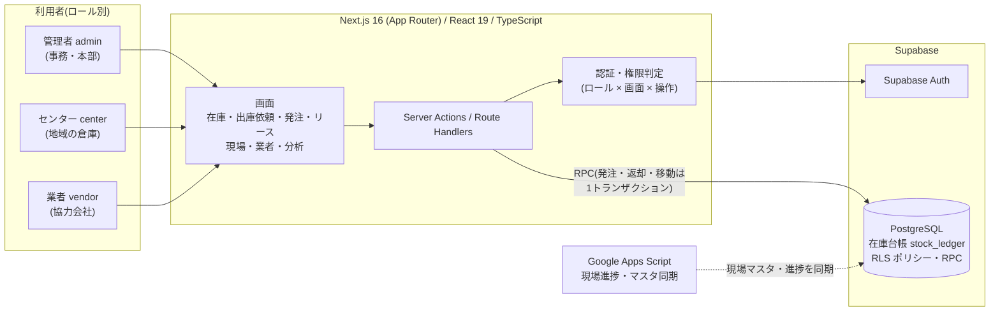

# 仮設資材 在庫・発注・リース管理システム

建設会社の仮設資材(足場など)の **在庫・出庫依頼・発注・リース・センター間移動** を一元管理する Web アプリです。
従来は LINE と Excel で運用していた業務を置き換えるために、要件定義から実装・テストまで一人で担当しました。

> 画面はお客様の業務データを含むため、スクリーンショットは載せていません。構成と設計は下記と `docs/` を参照してください。

## システム構成



## 設計のポイント

- **在庫は「台帳(stock_ledger)」の積み上げで管理**: 在庫数を直接書き換えず、入庫・出庫・返却・調整をすべて台帳に記録します。履歴を追跡でき、数量の食い違いを検証できます。
- **更新はデータベース側の関数(RPC)で一括実行**: 発注作成・現場返却・センター間移動など、複数テーブルにまたがる処理を 1 トランザクションにまとめ、途中で失敗しても中途半端な状態を残しません。
- **二重送信対策(冪等性)**: 発注作成・明細追加はリクエストの重複を検出し、ダブルクリックや再送で二重登録されません(`083`, `099` 番のマイグレーション)。
- **権限は二重で守る**: アプリ側のロール判定に加え、DB 側の RLS ポリシーでもロールごとのアクセス範囲を制限します。
- **認証は Fail Closed**: 環境変数が未設定・誤記でも「ログイン必須」側に倒れる設計です(`src/lib/auth/authz-flag.ts`)。
- **秘密情報はコードに置かない**: 鍵は環境変数で渡し、`service_role` はサーバー専用です。

## 主な機能

| 領域 | 内容 |
|---|---|
| 在庫 | 倉庫在庫・現場在庫、入出庫、在庫調整(承認フロー)、棚卸し、台帳照会・エクスポート |
| 出庫依頼 | 業者・現場からの依頼、ステータス遷移、返却・過返却の補正 |
| 発注 | 複数明細の発注、ロットサイズ制約、印刷用の伝票、仕入先管理 |
| リース | リース会社、リース在庫、借用一覧、返却期限の管理 |
| センター | 関西・関東・九州など地域センター別の在庫とセンター間移動 |
| 分析 | 現場別・商品別・期間別の動き、稼働率スナップショット |
| 管理 | ユーザー・業者・現場・元請の各マスタ、操作ログ、履歴アーカイブ |

## 技術スタック

Next.js 16 / React 19 / TypeScript / Tailwind CSS 4 / Supabase(PostgreSQL・Auth)/ Playwright(E2E)/ Vercel(ホスティング想定)

## ディレクトリ

```
資材管理実装/web/
  src/app/                 画面(ルーティング)
  src/lib/                 認証・在庫・発注などのドメインロジック
  supabase/migrations/     DB の変更履歴(001〜103、約100本)
  supabase/tests/          DB 側のテスト SQL
  e2e/                     Playwright による E2E テスト
docs/                      要件定義書、設計整理、決定ログ、ロードマップ(23_ が現行仕様の正本)
GENBA_WORK/                現場管理の Google Apps Script 群(職人進捗・是正報告・ダッシュボード など)
LINE発注/                  旧システム(LINE 発注受付の GAS)
```

## 開発の進め方

要件定義 → ヒアリング → 決定ログ → 実装計画 → 実装 → UAT という流れを `docs/` に残しています。
フェーズごとに「設計整理(確定/未確定の区別)」「決定事項(時系列ログ)」「実装計画(ゲート条件)」を作り、
**確定していない仕様は実装しない**ことを徹底しました。
