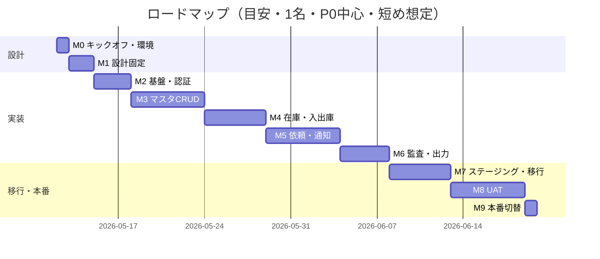

# ロードマップ（マイルストーン）

**対象**: Next.js ＋ PostgreSQL での新システム（現行 A-ZiP 系操作説明動画と会議メモに相当する機能を目標。UI は現行と同一でなくてよい）  
**前提**: 実働 **1日＝5時間**で換算。**熟練＋ Cursor 等の補助**、UI は業務に足りる素朴さでよい、インフラは Vercel＋Supabase 等の定番寄せ、という**短め目安**。  
**含まないもの**: 顧客の返信待ち・承認待ち・本番 UAT のカレンダー空白（その分は実カレンダーが伸びる）。

**更新日**: 2026-05-25

---

## 1. スコープの線引き

| フェーズ | 内容 |
|----------|------|
| **MVP（初回本番）** | `01_要件定義書` の **P0（F-01〜F-10）** に相当する機能＋移行検証の土台 |
| **第2弾** | **P1（F-11〜F-15）** をマイルストーン単位で分割リリース |

---

## 2. マイルストーン一覧

| ID | マイルストーン | 完了の定義（抜粋） | 想定作業日（5h/日） |
|----|----------------|-------------------|---------------------|
| **M0** | キックオフ・環境 | リポジトリ方針、ホスト（例: Vercel）、DB（例: Supabase/Neon）、`.env` 方針、秘密情報をコードに置かないルール合意 | **〜0.5**（実作業 **約2時間** で足りる想定） |
| **M1** | 設計の固定 | ER 図 v1、画面一覧 v1、権限マトリクス v1、`06_データフロー` と矛盾なし | **1〜3** |
| **M2** | 基盤・認証 | Next.js 起動、DB 接続、マイグレーション、ログイン、ロール（管理者／業者）が動作 | **2〜4** |
| **M3** | マスタ CRUD | 現場・得意先・商品・現場商品の一覧・登録・編集（F-01〜F-04） | **4〜8** |
| **M4** | 在庫台帳・入出庫 | `stock_ledger` 等で入庫・出庫がトランザクションで反映、在庫照会（F-05, F-08） | **3〜6** |
| **M5** | 出庫依頼〜社内受付 | 業者オーダー登録、社内通知、一覧・詳細（F-06, F-07）。現行の「受付→出庫」のデータ上のつながりが通る | **4〜8** |
| **M6** | 監査・帳票・出力（MVP 内） | 主要操作の監査ログ（F-10）、**CSV/Excel 相当のエクスポート**または伝票 PDF のいずれかを最小1系統（要件合意後） | **2〜5** |
| **M7** | ステージング・移行スクリプト | 本番相当データでの取込試験、`04` の移行チェックの一部が緑 | **3〜6** |
| **M8** | UAT・修正完了 | 合意した UAT シナリオで P0 欠陥ゼロ、本番切替手順ドラフト承認 | **3〜8**（**顧客都合で伸びやすい**） |
| **M9** | 本番切替 | 本番デプロイ、スモーク、当日サポート体制 | **0.5〜1** |
| **M10** | 第2弾（P1） | F-11〜F-15 をサブマイルに分割（例: M10a リース可視化、M10b LINE 通知、M10c アラート） | 別紙 |

**MVP 合計（M0〜M9）の目安**: **約 23〜49 作業日**（中央値イメージ **約 30〜35**）。  
従来の「保守的レンジ」より短くしたが、**在庫・同時更新・移行データの汚さ**で M4・M7・M8 は上限寄りになりやすい。

---

## 3. ガント風（週次の並び・目安）

並びは **直列前提**（1名）。ガントの **1 セグメント ≒ 上表の作業日の目安**（カレンダー日≠営業日の場合あり）。

開始日はプレースホルダ。実際の開始日に合わせてスライドしてください。

---

## 4. MVP（P0）完了の定義

### 4-1. 機能完了チェック（実装ベース）

| # | 完了条件 | 現状 |
|---|----------|:----:|
| 1 | マスタ CRUD（現場・得意先・商品） | ✅ |
| 2 | site_products（補助・並び替えのみ） | ✅（`docs/11`） |
| 3 | center 在庫照会（`/stock`） | ✅ |
| 4 | 暫定在庫メンテ（`/stock/new`、`/stock/[id]/edit`） | ✅ |
| 5 | stock_ledger + apply_stock_movement RPC | ✅（`docs/08`） |
| 6 | 入出庫の最小 UI（`/stock/move`、`/stock/ledger`） | ✅ |
| 7 | 出庫依頼フロー（`requested → accepted → shipped / cancelled`）+ `ship_stock_request` RPC | ✅（`docs/09`） |
| 8 | 監査ログ（最小・出庫依頼 4 イベント） | ✅（`007` 適用＋通し確認完了：created / accepted / cancelled / shipped） |
| 9 | 在庫不足時の挙動（`insufficient_stock` で `accepted` のまま戻る・電話運用継続） | ✅（`docs/07` P0-9） |

### 4-2. 整合性チェック（実装ベース）

- 在庫が**マイナスにならない**ことを確認（`apply_stock_movement` の制約）
- **二重引当が起きない**ことを確認（受付では引当しない・`docs/09`）
- 出庫済みの**取消や再 ship が起きない**ことを確認（`ship_stock_request` の FOR UPDATE + status guard）

### 4-3. ヒアリング・運用上の確定（MVP に閉じる）

| 項目 | 確定内容 | 根拠 |
|------|----------|------|
| 在庫不足時 | 電話運用継続。システム側でブロックしない | `docs/07` P0-9 |
| 業者向け在庫表示 | 倉庫在庫寄り | `docs/10` §4 |
| 現完滅失 | サンプル建設側・手動・固定タイミングなし | `docs/10` §2-4-1 |
| リース返却 | 基本フロー＋別現場振替時はリース会社へ連絡 | `docs/10` §3-3 |

### 4-4. UAT・移行に関する完了条件

- 切替手順とロールバック方針が**文書化**されている（`docs/03`・`docs/04`）
- UAT シナリオで P0 欠陥ゼロ（`docs/04`）
- 初期 stock_items 投入手順が**ステージングで通る**こと

---

## 5. P1 送り（MVP に含めないと明示する項目）

下記は**ヒアリングで存在は確定しているが、MVP には入れない**ことを明示する一覧。「未確定で出せない」ものとは区別する。

### 5-1. 機能の P1 送り

P1 は本番運用に向けて段階的に取り組む内容。下記の **P1-A は設計確定済み**（`docs/13`）。

| 項目 | 区分 | 根拠 |
|------|------|------|
| **認証・本格 RLS（Supabase Auth）** | **P1-A**（設計確定） | `docs/13` §3 / §7 |
| **業者専用ロール・現場絞り込み** | **P1-A**（設計確定） | `docs/13` §1 / §4 |
| **業者向け倉庫在庫画面（`/vendor/stock`）** | **P1-A**（設計確定） | `docs/13` §5 |
| **初期データ移行スクリプト** | **P1-A**（設計確定） | `docs/13` §9 |
| 貸出在庫（場所＝現場の保持） | P1-B | `docs/09` §4・§9。**詳細は `docs/14`〜`17`** |
| リース・完リース | P1-C | `docs/09` §9・`docs/10` §7。**`docs/14` B-REQ-08〜10** |
| 現完滅失 | P1-C | `docs/10` §7 |
| リース返却・別現場振替（システム化） | P1-C | `docs/10` §3-3 |
| 引当（受付時の仮押さえ） | P1-B（優先度低） | `docs/09` §1。**`docs/14` U-15** |
| システム内通知 | P1-D | `docs/01` F-07 |
| LINE 通知 | P1-D | `docs/01` F-14 |
| 残少アラート | P1-D | `docs/01` F-13 |
| Excel リース取込 | P1-C | `docs/01` F-12 |
| 希望納期・納期不可ワークフロー | P1-D | `docs/01` F-15 |

### 5-2. P2（運用改善・将来案として確認済み）

| 項目 | 区分 | 根拠 |
|------|------|------|
| 現完滅失の運用改善（催促・期限管理） | P2 | `docs/07` P2-5 |
| 在庫不足時の注文不可・代替手配 | P2 | `docs/07` P2-6 |
| Excel / 伝票出力 | P2 → **P1-E** に格上げ・詳細化 | `docs/07` P2-1。**`docs/18`〜`21`（オーダー・伝票・帳票）参照** |
| 監査ログの粒度拡張（マスタ変更等） | P2 | `docs/07` P2-2 |
| 既存 LINE 発注との役割分担 | P2 | `docs/07` P2-3 |
| 「ファンニュービー」等の用語整理 | P2 | `docs/07` P2-4 |

### 5-3. 未確定（時期未定・ヒアリング待ち）

| 項目 | 状態 |
|------|------|
| ~~認証・本格 RLS~~ | ✅ P1-A で設計確定（`docs/13`） |
| Excel 列定義（マスタ・在庫・依頼） | `docs/07` P1-1 |
| 移行時の在庫の正 | `docs/07` P1-2 |
| 通知ルール | `docs/07` P1-3 |
| 同時オーダー時の業務ルール | `docs/07` P1-4 |
| site_products 整備担当・取込手段 | `docs/02` B5 |
| パスワードリセット・業者退会・現場入替の運用 | `docs/13` §12 |

---

## 6. 改訂履歴

| 日付 | 内容 |
|------|------|
| 2026-05-11 | 初版 |
| 2026-05-12 | 想定作業日を短めに全面見直し（M0 を数時間規模に）。MVP 合計・ガントを追随。前提注記を追加。 |
| 2026-05-25 | §4 を P0 完了条件チェックリストに拡張、§5 を新設（P1 送り・P2・未確定の整理）。2026-05-25 ヒアリング反映。 |
| 2026-05-25 | §4-1 #8 監査ログを ✅ に更新（007 適用済み・4 イベント通し確認完了）。**P0 実装フェーズ完了**。残りは §4-4（UAT・移行・切替文書）。 |
| 2026-05-27 | §5-1 を P1-A〜P1-D 区分に整理。P1-A 設計確定（`docs/13`）を反映。§5-3 から認証・本格 RLS を削除（確定済み）。 |
| 2026-06-20 | §5-1 に P1-B 詳細（`docs/14`〜`17`）参照を追加。引当を優先度低と明記。 |
| 2026-07-30 | §5-2 の「Excel / 伝票出力」を P1-E として格上げ。詳細は `docs/18`〜`21`（オーダー・伝票・帳票）参照 |
