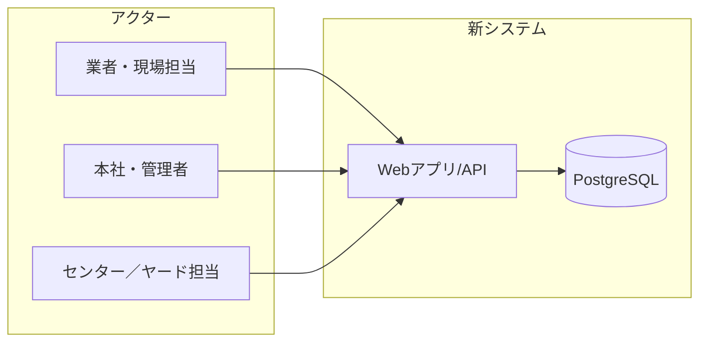
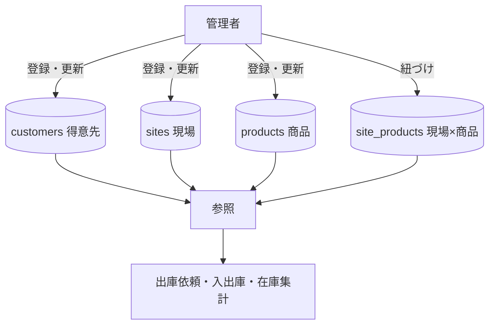
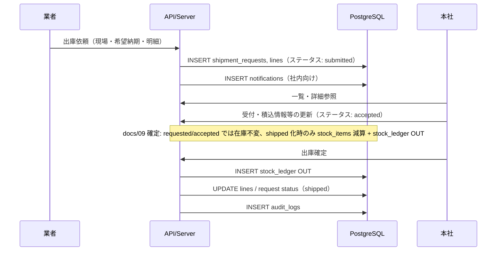
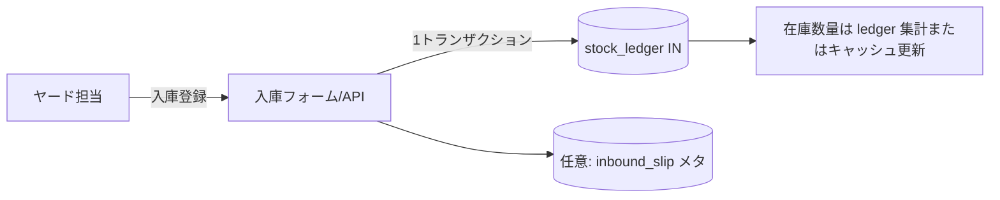
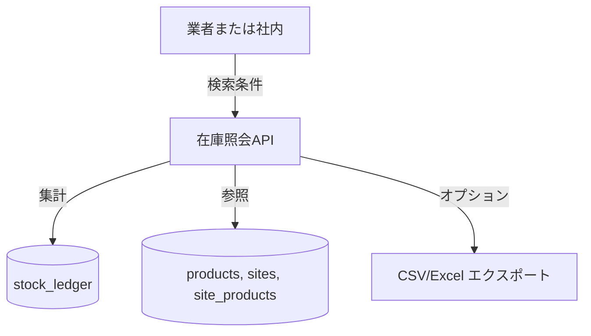
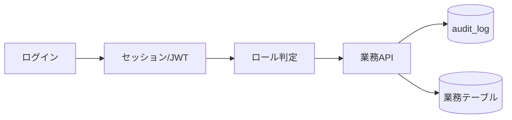
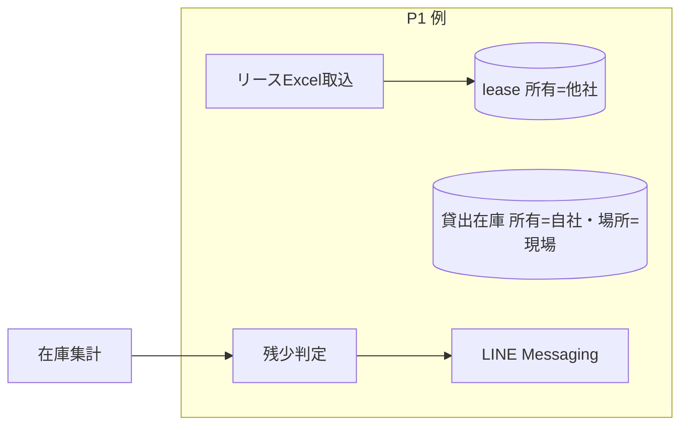

# データフロー（概念・現行業務相当）

**目的**: 実装前に「どのデータがどこを流れるか」を共有する。  
**注意**: 現行（A-ZiP 操作説明動画）の**画面名・帳票レイアウトと一致させる必要はない**。機能相当を満たすための論理フロー。  
**更新日**: 2026-05-11

---

## 1. システム境界とアクター

---

## 2. マスタ系データの流れ（参照の源泉）

管理者がマスタを整備し、以降の**在庫・依頼・入出庫**がここを参照する。

---

## 3. 出庫依頼（オーダー）〜社内確認〜出庫（コア）

現行動画では「出庫依頼入力 → オーダー一覧で受付 → 出庫入力 → 伝票」という流れ。**UI は新設**でよいが、データとしては次の関係が保てることを目標にする。

### 3.1 論理エンティティ（命名は実装で調整可）

| 論理名 | 役割 |
|--------|------|
| `shipment_request` | 出庫依頼ヘッダ（現場、商品、数量、ステータス、備考）／**MVP 実装名: `stock_requests`**（`docs/09` §3） |
| `shipment_request_line` | 明細（商品、数量。重量は属性または計算）／**MVP では明細テーブル無し: 1 依頼 = 1 商品 = 1 数量**（`docs/09` §3） |
| `notification` | 社内通知（誰宛／既読／種別）（**MVP 未実装**） |
| `stock_ledger` | 入出庫の事実（`product_id`、`location`、`movement_type`、`quantity`）。出庫依頼の `shipped` 化時も内部で `apply_stock_movement` 経由で 1 行追記（`docs/08`、`docs/09` §5） |
| `audit_log` | いつ誰が何をしたか（F-10）（**MVP 未実装**） |

---

## 4. 入庫

現行では「按分実行でプレビュー→継続登録→伝票」。新システムでは **同一トランザクション内の整合性** と **明細プレビュー** をどちらで表現するか実装時に決める。

---

## 5. 在庫照会（読み取り）

- **センター／ヤード在庫**と**現場残**は、集計キー（拠点種別・現場ID）でビューを分ける想定。

---

## 6. 認証・監査（横断）

---

## 7. 第2弾（P1）で追加する流れ（参考）

用語の正本は `docs/10_用語_資材在庫概念.md`。ノード名は `docs/10` の 3 軸モデル（所有・場所・帳簿状態）に従う。

---

## 8. 次に実装で固定すること（本ドキュメントの出口）

1. ~~**出庫依頼のステータス**一覧~~ → **確定済み（`docs/09` §2）**: `requested → accepted → shipped`、または `→ cancelled`。`shipped` 後の取消・戻し入庫は MVP では作らない。
2. ~~**在庫引当タイミング**~~ → **確定済み（`docs/09` §1 / §5）**: 受付では引当せず、**`shipped` 化時のみ** `apply_stock_movement('out')` で `center` から減算。在庫不足は `insufficient_stock` で失敗。
3. **拠点**（センター／現場）をデータモデルにどう持つか。**MVP は `center` 固定**（`docs/09` §4）。現場残・貸出在庫・リースは未確定（`docs/07` P0-6）。
4. **伝票・Excel**は MVP でどこまで再現するか（`05` M6 と合わせて顧客合意）。

---

## 9. 改訂履歴

| 日付 | 内容 |
|------|------|
| 2026-05-11 | 初版 |
| 2026-05-20 | §3 / §3.1 / §8 を `docs/09` 確定内容に整合（在庫引当タイミング・出庫依頼ステータス・実装名） |
